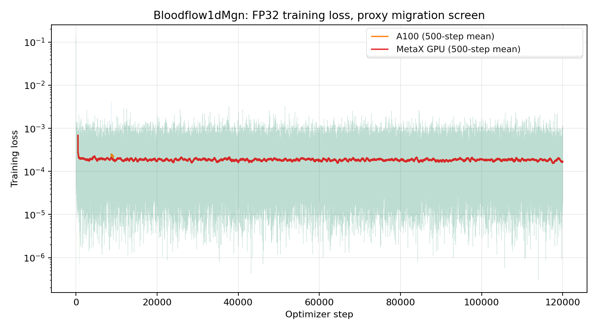

# 沐曦 GPU 运行 PhysicsNeMo BloodFlow1D MGN 说明文档

## 一、BloodFlow1D MGN 简介

BloodFlow1D MGN 是 [PhysicsNeMo v2.0.0](https://github.com/NVIDIA/physicsnemo/tree/v2.0.0/examples/healthcare/bloodflow_1d_mgn) 的心血管一维降阶血流代理模型，面向患者特异性动脉中心线图，使用当前压力、流量、截面积、切向量、节点类型、心动周期、RCR出口参数和边界信息，预测下一时刻压力及流量增量。本文使用第二节指定标签的镜像，其中 PhysicsNeMo 版本为 `2.0.0`。

本目录采用文档与容器适配方式，不包含 PhysicsNeMo 源码、心血管仿真 VTP 数据、预处理图和模型权重。PhysicsNeMo 数据包含8个患者几何的310组仿真，`raw_dataset/download_dataset.sh` 从 NGC 获取压缩包，`generate_graphs.py` 预处理。几何来源和使用条件以[PhysicsNeMo 案例](https://github.com/NVIDIA/physicsnemo/tree/v2.0.0/examples/healthcare/bloodflow_1d_mgn)及 [Vascular Model Repository](https://vascularmodel.com/FAQs.html) 说明为准。

## 二、沐曦 GPU 环境配置与运行

### 2.1 环境准备

使用沐曦开发者社区提供的[PhysicsNeMo MACA 镜像](https://developer.metax-tech.com/softnova/docker?chip_name=MXC500&package_name=physicsnemo-maca:2.0.0-3.9.0.12-torch2.8-py312-ubuntu24.04-amd64)启动容器：

```bash
docker run --rm -it \
  --device=/dev/mxcd \
  --device=/dev/dri \
  --group-add video \
  --shm-size=8G \
  --security-opt seccomp=unconfined \
  --ulimit memlock=-1 \
  --ulimit stack=67108864 \
  -v /host_dir:/workspace \
  cr.metax-tech.com/public-ai-release/physicsnemo-maca:2.0.0-3.9.0.12-torch2.8-py312-ubuntu24.04-amd64 \
  /bin/bash
```

**参数说明：**

- `--device=/dev/mxcd --device=/dev/dri`：将沐曦 GPU 设备节点传入容器。
- `--group-add video`：将容器进程加入 `video` 组，以便访问 GPU 设备。
- `--shm-size=8G`：设置共享内存大小，供 PyTorch 和图数据加载使用。
- `--security-opt seccomp=unconfined`：允许 MACA 运行时使用所需的系统调用。
- `--ulimit memlock=-1`：取消内存锁定限制，避免 GPU 运行时申请锁页内存失败。
- `--ulimit stack=67108864`：设置线程栈大小，满足模型和数据处理过程的运行需求。
- `-v /host_dir:/workspace`：挂载工作目录；`/host_dir` 是主机路径，`/workspace` 是容器内路径。

### 2.2 验证环境

进入容器后，先验证沐曦 PyTorch 与 GPU 是否可用：

```bash
python -c "import torch; assert torch.cuda.is_available(); print('PyTorch version:', torch.__version__); print('CUDA OK:', torch.cuda.get_device_name(0))"
```

命令应打印 PyTorch 版本和 `cuda:0` 对应的沐曦 GPU 名称。例如：

```text
PyTorch version: 2.8.0+metax3.9.0.8
CUDA OK: MetaX GPU
```

实际版本号和设备名称以使用的 PhysicsNeMo MACA 镜像及设备为准。

如果 `torch.cuda.is_available()` 为 `False`，请先检查宿主机驱动、`/dev/mxcd` 和 `/dev/dri` 设备节点挂载、`video` 用户组权限以及容器启动参数，再继续安装 BloodFlow1D MGN。

### 2.3 配置 MACA 编译环境

PhysicsNeMo MACA 镜像已配置 MACA 编译环境，并预装沐曦 PyTorch、 PhysicsNeMo 和 Warp；本案例不需要重复安装这些组件。进入容器后可验证：

```bash
python -c "import torch, physicsnemo, warp; assert torch.cuda.is_available(); print('PyTorch:', torch.__version__); print('PhysicsNeMo:', physicsnemo.__version__); print('Warp:', warp.__version__)"
```

命令应输出镜像内各组件的实际版本。例如：

```text
PyTorch: 2.8.0+metax3.9.0.8
PhysicsNeMo: 2.0.0
Warp: 1.12.1
```

### 2.4 安装 BloodFlow1D MGN 依赖

推荐使用第四节 Dockerfile 构建的镜像。案例依赖 VTK 读取血管 VTP 图，并使用 Matplotlib 绘制推理结果；Dockerfile 安装所需依赖。

构建后可检查案例入口：

~~~bash
cd /root/physicsnemo/examples/healthcare/bloodflow_1d_mgn
python -c "import physicsnemo, warp, torch_scatter, vtk; import train, inference, generate_graphs, graph_tools, vtk_tools; print('entry imports PASS')"
~~~

## 三、运行与验证

### 3.1 数据准备、训练与推理

官方案例使用心血管中心线 VTP 仿真数据。在 PhysicsNeMo 源码目录按官方入口下载并生成图：

```bash
cd examples/healthcare/bloodflow_1d_mgn
pip install gdown
cd raw_dataset
bash download_dataset.sh
cd ..
python generate_graphs.py
```

数据下载脚本依赖上游数据源的可用性。根据 `config.yaml` 设置数据路径和训练参数后，使用官方入口训练；推理前在配置中设置模型和图：

```bash
python train.py
python inference.py
```

以下对比使用 VPD 虚拟患者代理数据构建血管拓扑图：从 20,000 名患者中划分 18,000 名用于训练、2,000 名留出，重建压力、流量和面积的周期序列。模型采用 18 维节点输入、4 维边输入及 2 维输出；代理图特征与官方 VTP 中心线图不同。A100 与 MetaX GPU 从相同初始权重出发，各进行 120,000 次 FP32 更新。

### 3.2 训练与推理结果

下图展示 A100 与 MetaX GPU 的训练 Loss，曲线为 500 步滑动均值，两端变化趋势基本一致。



## 四、Dockerfile 构建

本目录提供可直接构建的Dockerfile。Dockerfile 使用上述 PhysicsNeMo MACA 镜像，安装第二节列出的依赖，并在构建时检查 PhysicsNeMo 版本和目标案例入口；构建过程不打包心血管仿真 VTP 数据、预处理图和模型权重。

在 `Bloodflow1dMgn` 目录执行：

```bash
docker build --build-arg PYPI_INDEX_URL=http://repo.metax-tech.com/r/pypi/simple \
  --build-arg VTK_WHEEL_URL=https://mirrors.aliyun.com/pypi/packages/c5/6c/e5544c77b568bfbcc3592fb5e23a5dee8e84df9ee316230509362fb6d432/vtk-9.5.2-cp312-cp312-manylinux2014_x86_64.manylinux_2_17_x86_64.whl \
  -t physicsnemo-bloodflow1d-mgn-maca:2.0.0-3.9.0.12 .
```

以上构建命令指定 Python 包索引和 VTK wheel 地址。

构建完成后，使用下列命令启动镜像：

```bash
docker run --rm -it \
  --device=/dev/mxcd \
  --device=/dev/dri \
  --group-add video \
  --shm-size=8G \
  --security-opt seccomp=unconfined \
  --ulimit memlock=-1 \
  --ulimit stack=67108864 \
  -v /host_dir:/workspace \
  physicsnemo-bloodflow1d-mgn-maca:2.0.0-3.9.0.12 \
  /bin/bash
```

请将 `/host_dir` 替换为主机侧实际工作目录。该挂载用于数据及输出。

## 五、其他

1. 开发者在初次使用曦云 GPU 运行 BloodFlow1D MGN 时，遵循本手册搭建环境后，可以按照 [PhysicsNeMo BloodFlow1D MGN 官网](https://github.com/NVIDIA/physicsnemo/tree/v2.0.0/examples/healthcare/bloodflow_1d_mgn)的教程开展训练及推理。
2. 沐曦仅维护部分 case 的正确性，如出现运行问题，可提交 issue，亦可以在[沐曦开发者社区](https://developer.metax-tech.com)提交 bug 反馈。
3. 了解更多沐曦开源项目，请参考[沐曦开源社区](https://github.com/metax-maca)。

---

本文档仅提供相关软件的配置与使用说明，不包含亦不分发前述软件的源代码或目标代码，且不涉及对其源代码的任何修改。您按照本文档配置、部署或使用相关软件时，应遵守适用许可证规定的条款与条件。相关软件的源代码、许可证全文、版权与归属声明及其他项目文档，请以其官方网站或原始发布页面为准。

Copyright (c) 2026 MetaX Integrated Circuits (Shanghai) Co., Ltd. All rights reserved.
