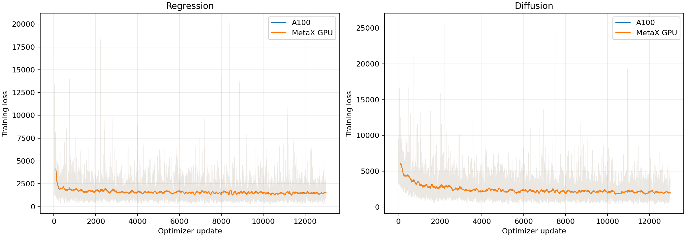
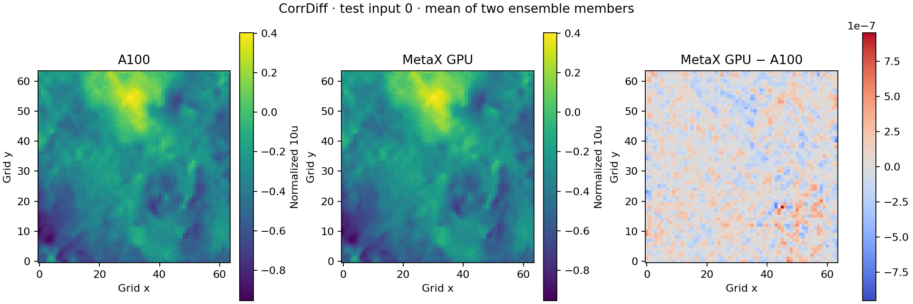

# 沐曦 GPU 运行 PhysicsNeMo CorrDiff 说明文档

## 一、 PhysicsNeMo CorrDiff 简介

CorrDiff 是面向公里级天气降尺度的生成式校正扩散模型，将粗分辨率天气条件映射为高分辨率天气场。本文档按 HRRR-Mini 任务验证 6 通道条件输入和 `10u`、`10v` 两通道输出；PhysicsNeMo v2.0.0 tag 经核对对应提交 SHA `1ca85d65ac2ce28ea9762910c09a954c08a37140`。

本目录仅提供 Dockerfile、LICENSE 和本说明，不包含 PhysicsNeMo 源码、训练数据或模型权重。真实 HRRR-Mini 训练需要从 [NVIDIA NGC HRRR-Mini 数据资源](https://catalog.ngc.nvidia.com/orgs/nvidia/teams/modulus/resources/modulus_datasets-hrrr_mini) 获取 NetCDF 数据与统计文件；扩散训练还依赖预先训练的 regression checkpoint。配置见[PhysicsNeMo CorrDiff 案例说明](https://github.com/NVIDIA/physicsnemo/tree/v2.0.0/examples/weather/corrdiff)。

## 二、沐曦 GPU 环境配置与运行

### 2.1 环境准备

使用沐曦开发者社区提供的[PhysicsNeMo MACA 镜像](https://developer.metax-tech.com/softnova/docker?chip_name=MXC500&package_name=physicsnemo-maca:2.0.0-3.9.0.12-torch2.8-py312-ubuntu24.04-amd64)启动容器：

```bash
docker run --rm -it \
  --device=/dev/mxcd \
  --device=/dev/dri \
  --group-add video \
  --shm-size=8G \
  --security-opt seccomp=unconfined \
  --ulimit memlock=-1 \
  --ulimit stack=67108864 \
  -v /host_dir:/workspace \
  cr.metax-tech.com/public-ai-release/physicsnemo-maca:2.0.0-3.9.0.12-torch2.8-py312-ubuntu24.04-amd64 \
  /bin/bash
```

**参数说明：**

- `--device=/dev/mxcd --device=/dev/dri`：将沐曦 GPU 设备节点传入容器。
- `--group-add video`：将容器进程加入 `video` 组，以便访问 GPU 设备。
- `--shm-size=8G`：设置共享内存大小，供 PyTorch 和图数据加载使用。
- `--security-opt seccomp=unconfined`：允许 MACA 运行时使用所需的系统调用。
- `--ulimit memlock=-1`：取消内存锁定限制，避免 GPU 运行时申请锁页内存失败。
- `--ulimit stack=67108864`：设置线程栈大小，满足模型和数据处理过程的运行需求。
- `-v /host_dir:/workspace`：挂载工作目录；`/host_dir` 是主机路径，`/workspace` 是容器内路径。

### 2.2 验证环境

进入容器后，先验证沐曦 PyTorch 与 GPU 是否可用：

```bash
python -c "import torch; assert torch.cuda.is_available(); print('PyTorch version:', torch.__version__); print('CUDA OK:', torch.cuda.get_device_name(0))"
```

本次在 MetaX C500 上的输出为：

```text
PyTorch version: 2.8.0+metax3.9.0.8
CUDA OK: MetaX C500
```

如果 `torch.cuda.is_available()` 为 `False`，请检查宿主机驱动、`/dev/mxcd` 和 `/dev/dri` 设备节点挂载、`video` 用户组权限以及容器启动参数，再继续安装该案例。

### 2.3 配置 MACA 编译环境

PhysicsNeMo MACA 镜像已配置 MACA 编译环境，并预装沐曦 PyTorch、 PhysicsNeMo 和 Warp；本案例不需要重复安装这些组件。进入容器后可验证：

```bash
python -c "import torch, physicsnemo, warp; assert torch.cuda.is_available(); print('PyTorch:', torch.__version__); print('PhysicsNeMo:', physicsnemo.__version__); print('Warp:', warp.__version__)"
```

本次验证输出：

```text
PyTorch: 2.8.0+metax3.9.0.8
PhysicsNeMo: 2.0.0
Warp: 1.12.1
```


### 2.4 安装 CorrDiff 依赖

推荐使用第四节 Dockerfile 构建的镜像。镜像已包含 PhysicsNeMo 、沐曦 PyTorch 和 Warp。

PhysicsNeMo `requirements.txt` 约束：`netCDF4>=1.7.2`、`hydra-core>=1.2.0`、`omegaconf>=2.3.0`、`wandb>=0.13.7`、`nvtx>=0.2.8`、`dask>=2025.3.0`、`xskillscore>=0.0.26`、`cftime>=1.6.2`、`opencv-python>=4.11.0.86`、`numba>=0.61.0`、`scipy>=1.15.1`、`typer>=0.16.0`、`psutil>=6.0.0`；另安装 `tensorboard` 与 `zarr==2.18.7`。Zarr 2 用于案例数据管线兼容。

对应的安装命令：

```bash
python -m pip install --index-url=https://pypi.tuna.tsinghua.edu.cn/simple -r /root/physicsnemo/examples/weather/corrdiff/requirements.txt
python -m pip install --index-url=https://pypi.tuna.tsinghua.edu.cn/simple tensorboard
python -m pip install --index-url=https://pypi.tuna.tsinghua.edu.cn/simple zarr==2.18.7
```

验证依赖：

```bash
cd /root/physicsnemo/examples/weather/corrdiff
python train.py --cfg job --config-name=config_training_hrrr_mini_diffusion.yaml
```

## 三、运行与验证

### 3.1 数据准备与运行命令

从 [NVIDIA NGC HRRR-Mini 数据页面](https://catalog.ngc.nvidia.com/orgs/nvidia/teams/modulus/resources/modulus_datasets-hrrr_mini)获取数据及归一化统计文件，并在 HRRR-Mini 配置中设置实际路径。进入官方案例目录，依次训练 regression 与 diffusion：

```bash
cd /root/physicsnemo/examples/weather/corrdiff
python train.py --config-name=config_training_hrrr_mini_regression.yaml
python train.py --config-name=config_training_hrrr_mini_diffusion.yaml \
  ++training.io.regression_checkpoint_path=/path/to/regression/model
```

将路径替换为 regression 训练生成的权重。完成训练后，使用两个模型权重生成预测：

```bash
python generate.py --config-name=config_generate_hrrr_mini.yaml \
  ++generation.io.res_ckpt_filename=/path/to/diffusion/model \
  ++generation.io.reg_ckpt_filename=/path/to/regression/model
```

### 3.2 扩展训练与推理结果

使用 HRRR-Mini 数据，regression 和 diffusion 两阶段各使用 52,000 个不同训练样本，A100 与 MetaX GPU 从相同初始权重分别训练 13,000 次更新。下图展示逐步训练 Loss，实线为 100 次更新的滑动均值；两个阶段的双端 Loss 均处于同一量级。



下图展示两端使用相同训练后模型权重和相同初始噪声时，测试输入 0 的 `10u` 归一化预测场；每端取两个集合成员的均值，右图为两端差值。对 16 个测试输入和两个输出变量分别计算，相对 A100 的集合均值 L2 最大为 5.52e-7，两端相同权重下的推理结果基本一致。



## 四、Dockerfile 构建

本目录提供可直接构建的 Dockerfile。Dockerfile 以 `cr.metax-tech.com/public-ai-release/physicsnemo-maca:2.0.0-3.9.0.12-torch2.8-py312-ubuntu24.04-amd64` 为基础，移除基础镜像中不兼容的 `flash-attn-3`，安装本节列出的额外依赖，并在构建时导入 SongUNet 与 CorrDiff 依赖，并加载 HRRR-Mini Hydra 训练配置。构建上下文为本模型目录；镜像不打包 PhysicsNeMo 源码、训练数据和模型权重。

在 `CorrDiff` 目录执行：

```bash
unset no_proxy https_proxy NO_PROXY HTTPS_PROXY HTTP_PROXY http_proxy
docker build --network=host --build-arg PYPI_INDEX_URL=https://pypi.tuna.tsinghua.edu.cn/simple -t physicsnemo-corrdiff:c500 .
```

构建完成后，使用下列命令启动镜像，并按第三节执行 CorrDiff 验证：

```bash
docker run --rm -it \
  --device=/dev/mxcd \
  --device=/dev/dri \
  --group-add video \
  --shm-size=8G \
  --security-opt seccomp=unconfined \
  --ulimit memlock=-1 \
  --ulimit stack=67108864 \
  -v /host_dir:/workspace \
  physicsnemo-corrdiff:c500 \
  /bin/bash
```

请将 `/host_dir` 替换为主机侧实际工作目录；此挂载用于放置数据和保存输出。

## 五、其他

1. 开发者在初次使用曦云 GPU 运行 CorrDiff 时，遵循本手册搭建环境后，可以按照 [PhysicsNeMo CorrDiff 官网](https://github.com/NVIDIA/physicsnemo/tree/v2.0.0/examples/weather/corrdiff)的教程开展训练及推理。
2. 沐曦仅维护部分 case 的正确性，如出现运行问题，可提交 issue，亦可以在[沐曦开发者社区](https://developer.metax-tech.com)提交 bug 反馈。
3. 了解更多沐曦开源项目，请参考[沐曦开源社区](https://github.com/metax-maca)。

---

本文档仅提供相关软件的配置与使用说明，不包含亦不分发前述软件的源代码或目标代码，且不涉及对其源代码的任何修改。您按照本文档配置、部署或使用相关软件时，应遵守适用许可证规定的条款与条件。相关软件的源代码、许可证全文、版权与归属声明及其他项目文档，请以其官方网站或原始发布页面为准。

Copyright (c) 2026 MetaX Integrated Circuits (Shanghai) Co., Ltd. All rights reserved.
