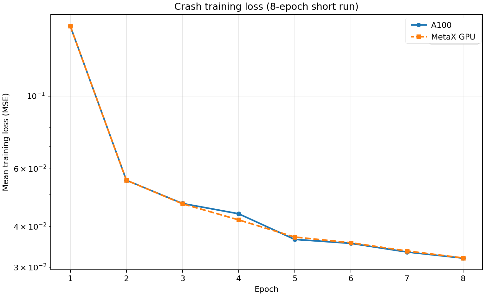
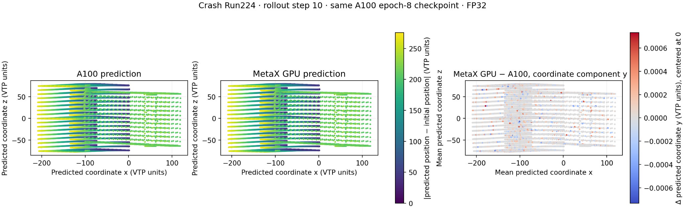

# 沐曦 GPU 运行 PhysicsNeMo Automotive Crash Dynamics 说明文档

## 一、 PhysicsNeMo Automotive Crash Dynamics 简介

Automotive Crash Dynamics 面向汽车碰撞结构响应预测，以网格坐标、材料/几何特征和历史运动状态为输入，通过 Transolver 自回归 rollout 预测后续节点位置。本文档验证案例配置的 128 个节点与 3 维位置输出。PhysicsNeMo v2.0.0 tag 经核对对应提交 SHA `1ca85d65ac2ce28ea9762910c09a954c08a37140`。

本目录仅提供 Dockerfile、LICENSE 和本说明，不包含 PhysicsNeMo 源码、训练数据或模型权重。真实案例需要 LS-DYNA 碰撞仿真数据（`d3plot` 与 `.k` 文件），并可通过 [PhysicsNeMo-Curator](https://github.com/NVIDIA/physicsnemo-curator) 预处理为 VTP 或 Zarr。格式和配置见[PhysicsNeMo Crash Dynamics 说明](https://github.com/NVIDIA/physicsnemo/tree/v2.0.0/examples/structural_mechanics/crash)。

## 二、沐曦 GPU 环境配置与运行

### 2.1 环境准备

使用沐曦开发者社区提供的[PhysicsNeMo MACA 镜像](https://developer.metax-tech.com/softnova/docker?chip_name=MXC500&package_name=physicsnemo-maca:2.0.0-3.9.0.12-torch2.8-py312-ubuntu24.04-amd64)启动容器：

```bash
docker run --rm -it \
  --device=/dev/mxcd \
  --device=/dev/dri \
  --group-add video \
  --shm-size=8G \
  --security-opt seccomp=unconfined \
  --ulimit memlock=-1 \
  --ulimit stack=67108864 \
  -v /host_dir:/workspace \
  cr.metax-tech.com/public-ai-release/physicsnemo-maca:2.0.0-3.9.0.12-torch2.8-py312-ubuntu24.04-amd64 \
  /bin/bash
```

**参数说明：**

- `--device=/dev/mxcd --device=/dev/dri`：将沐曦 GPU 设备节点传入容器。
- `--group-add video`：将容器进程加入 `video` 组，以便访问 GPU 设备。
- `--shm-size=8G`：设置共享内存大小，供 PyTorch 和图数据加载使用。
- `--security-opt seccomp=unconfined`：允许 MACA 运行时使用所需的系统调用。
- `--ulimit memlock=-1`：取消内存锁定限制，避免 GPU 运行时申请锁页内存失败。
- `--ulimit stack=67108864`：设置线程栈大小，满足模型和数据处理过程的运行需求。
- `-v /host_dir:/workspace`：挂载工作目录；`/host_dir` 是主机路径，`/workspace` 是容器内路径。

### 2.2 验证环境

进入容器后，先验证沐曦 PyTorch 与 GPU 是否可用：

```bash
python -c "import torch; assert torch.cuda.is_available(); print('PyTorch version:', torch.__version__); print('CUDA OK:', torch.cuda.get_device_name(0))"
```

本次在 MetaX C500 上的输出为：

```text
PyTorch version: 2.8.0+metax3.9.0.8
CUDA OK: MetaX C500
```

如果 `torch.cuda.is_available()` 为 `False`，请检查宿主机驱动、`/dev/mxcd` 和 `/dev/dri` 设备节点挂载、`video` 用户组权限以及容器启动参数，再继续安装该案例。

### 2.3 配置 MACA 编译环境

PhysicsNeMo MACA 镜像已配置 MACA 编译环境，并预装沐曦 PyTorch、 PhysicsNeMo 和 Warp；本案例不需要重复安装这些组件。进入容器后可验证：

```bash
python -c "import torch, physicsnemo, warp; assert torch.cuda.is_available(); print('PyTorch:', torch.__version__); print('PhysicsNeMo:', physicsnemo.__version__); print('Warp:', warp.__version__)"
```

本次验证输出：

```text
PyTorch: 2.8.0+metax3.9.0.8
PhysicsNeMo: 2.0.0
Warp: 1.12.1
```


### 2.4 安装 Crash Dynamics 依赖

推荐使用第四节 Dockerfile 构建的镜像。镜像已包含 PhysicsNeMo 、沐曦 PyTorch 和 Warp。

PhysicsNeMo `requirements.txt` 约束 `jaxtyping==0.3.3`、`lasso-python==2.0.3`、`torch_geometric==2.6.1`、`torch_scatter>=2.1.2`；Dockerfile 另装 `tensorboard` 与 PyVista（验证版本 `0.49.2`，并由其提供 VTK 读写支持）。

对应的安装命令：

```bash
python -m pip install --index-url=https://pypi.tuna.tsinghua.edu.cn/simple -r /root/physicsnemo/examples/structural_mechanics/crash/requirements.txt
python -m pip install --index-url=https://pypi.tuna.tsinghua.edu.cn/simple tensorboard
python -m pip install --index-url=https://pypi.tuna.tsinghua.edu.cn/simple pyvista
```

验证依赖：

```bash
cd /root/physicsnemo/examples/structural_mechanics/crash
python train.py --help
```

## 三、运行与验证

### 3.1 训练与推理命令

#### 数据准备

官方案例需要自行获取 LS-DYNA 碰撞仿真数据，包括 `d3plot` 和 `.k` 文件；案例本身未提供数据集下载命令。可按 [PhysicsNeMo-Curator 官方说明](https://github.com/NVIDIA/physicsnemo-curator) 将仿真数据预处理为 VTP 或 Zarr，再按案例配置训练、验证和推理目录。也可使用符合案例读取格式的现有数据。


准备碰撞仿真数据，在 `conf/training/default.yaml` 中配置训练和验证数据路径，在 `conf/inference/default.yaml` 中配置推理数据及输出路径。进入官方案例目录执行训练：

```bash
cd /root/physicsnemo/examples/structural_mechanics/crash
python train.py
```

训练完成后，使用训练检查点和归一化统计数据执行推理：

```bash
python inference.py
```

案例配置位于 `conf/`；推理输入按算例分别存放在子目录中，预测网格以 VTP 格式写入配置的输出目录。

### 3.2 训练与推理结果

采用 Transolver 自回归模型，A100 与 MetaX GPU 使用相同初始权重、数据顺序和 FP32 配置，分别训练 8 个 epoch，每个 epoch 使用 124 条训练序列。留出集包含 7 条序列，每条序列使用 11 帧进行 10 步滚动推理。数据时间字段经过适配，物理时间间隔尚未确认。

下图对比两端各 epoch 的平均训练 MSE Loss。两端 Loss 整体下降，变化趋势基本一致；第 8 个 epoch 相对 A100 的差异为 0.16%。



下图展示两端使用相同的第 8 个 epoch 训练后模型权重对 Run224 第 10 步的预测位置；颜色表示相对初始位置的位移幅值，右图为两端预测坐标 y 分量的差值。以 A100 为基线，对全部 7 条留出序列、10 个推理步和所有节点的三维坐标计算，整体相对 L2 为 1.30e-7，两端相同权重下的推理结果基本一致。



## 四、Dockerfile 构建

本目录提供可直接构建的 Dockerfile。Dockerfile 以 `cr.metax-tech.com/public-ai-release/physicsnemo-maca:2.0.0-3.9.0.12-torch2.8-py312-ubuntu24.04-amd64` 为基础，移除基础镜像中不兼容的 `flash-attn-3`，安装本节列出的额外依赖，并在构建时导入 Transolver 与 VTP 读取依赖，并运行 `train.py --help`。构建上下文为本模型目录；镜像不打包 PhysicsNeMo 源码、训练数据和模型权重。

在 `Crash` 目录执行：

```bash
unset no_proxy https_proxy NO_PROXY HTTPS_PROXY HTTP_PROXY http_proxy
docker build --network=host --build-arg PYPI_INDEX_URL=https://pypi.tuna.tsinghua.edu.cn/simple -t physicsnemo-crash:c500 .
```

构建完成后，使用下列命令启动镜像，并按第三节执行 Automotive Crash Dynamics 验证：

```bash
docker run --rm -it \
  --device=/dev/mxcd \
  --device=/dev/dri \
  --group-add video \
  --shm-size=8G \
  --security-opt seccomp=unconfined \
  --ulimit memlock=-1 \
  --ulimit stack=67108864 \
  -v /host_dir:/workspace \
  physicsnemo-crash:c500 \
  /bin/bash
```

请将 `/host_dir` 替换为主机侧实际工作目录；此挂载用于放置数据和保存输出。

## 五、其他

1. 开发者在初次使用曦云 GPU 运行 Automotive Crash Dynamics 时，遵循本手册搭建环境后，可以按照 [PhysicsNeMo Automotive Crash Dynamics 官网](https://github.com/NVIDIA/physicsnemo/tree/v2.0.0/examples/structural_mechanics/crash)的教程开展训练及推理。
2. 沐曦仅维护部分 case 的正确性，如出现运行问题，可提交 issue，亦可以在[沐曦开发者社区](https://developer.metax-tech.com)提交 bug 反馈。
3. 了解更多沐曦开源项目，请参考[沐曦开源社区](https://github.com/metax-maca)。

---

本文档仅提供相关软件的配置与使用说明，不包含亦不分发前述软件的源代码或目标代码，且不涉及对其源代码的任何修改。您按照本文档配置、部署或使用相关软件时，应遵守适用许可证规定的条款与条件。相关软件的源代码、许可证全文、版权与归属声明及其他项目文档，请以其官方网站或原始发布页面为准。

Copyright (c) 2026 MetaX Integrated Circuits (Shanghai) Co., Ltd. All rights reserved.
