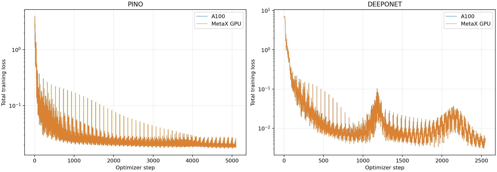
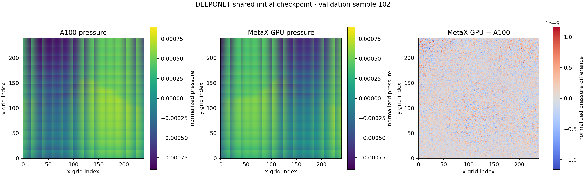

# 沐曦 GPU 运行 PhysicsNeMo Darcy Physics Informed 说明文档

## 一、Darcy Physics Informed 简介

本案例使用 PhysicsNeMo 的 PINO 和 DeepONet 模型，结合数据与物理约束求解二维 Darcy 方程。案例实现见 [PhysicsNeMo 官方案例](https://github.com/NVIDIA/physicsnemo/tree/v2.0.0/examples/cfd/darcy_physics_informed)。本目录提供容器构建文件、说明和验证图，不包含数据集或模型权重。

## 二、沐曦 GPU 环境配置

### 2.1 环境准备

使用第四节 Dockerfile 构建的镜像，或使用沐曦 PhysicsNeMo MACA 基础镜像并安装下述依赖。启动容器时挂载 GPU 设备和工作目录：

```bash
docker run --rm -it \
  --device=/dev/mxcd --device=/dev/dri --group-add video \
  --shm-size=8G --security-opt seccomp=unconfined \
  --ulimit memlock=-1 --ulimit stack=67108864 \
  -v /host_dir:/workspace \
  physicsnemo-darcy-physics-informed:2.0.0-maca /bin/bash
```

将 `/host_dir` 替换为实际工作目录。进入后检查设备和框架：

```bash
python -c "import torch, physicsnemo; assert torch.cuda.is_available(); print(torch.__version__, physicsnemo.__version__, torch.cuda.get_device_name(0))"
```

### 2.2 案例依赖与数据

Dockerfile 以 PhysicsNeMo MACA 镜像为基础，补充 PhysicsNeMo-Sym、`symengine`、`matplotlib` 和 `gdown`。使用基础镜像手动配置时，执行：

```bash
python -m pip uninstall -y flash-attn-3
python -m pip install gdown matplotlib symengine==0.14.1 pint tensorboard transforms3d
python -m pip install --no-deps --no-build-isolation 'nvidia-physicsnemo.sym==2.0.0'
ln -s /opt/conda/lib/python3.12/site-packages/physicsnemo/sym /root/physicsnemo/physicsnemo/sym
```

在官方案例目录运行 `python download_data.py` 可下载并预处理数据，生成 `datasets/Darcy_241/train.hdf5` 和 `validation.hdf5`。也可将已有数据挂载或链接到案例目录下的相同路径。


## 三、运行与验证

### 3.1 训练与推理命令

#### 数据准备

在官方案例目录下载并预处理 Darcy 数据：

```bash
cd /root/physicsnemo/examples/cfd/darcy_physics_informed
python download_data.py
```

脚本从 Google Drive 获取 Darcy 数据，并生成 `datasets/Darcy_241/train.hdf5` 和 `validation.hdf5`。


在官方案例目录准备 `datasets/Darcy_241` 数据后，运行 PINO 或 DeepONet 训练：

```bash
cd /root/physicsnemo/examples/cfd/darcy_physics_informed
python darcy_physics_informed_fno.py
```

```bash
cd /root/physicsnemo/examples/cfd/darcy_physics_informed
python darcy_physics_informed_deeponet.py
```

官方入口在训练期间执行验证推理并保存结果图和检查点；PINO 与 DeepONet 的配置分别位于 `conf/config_pino.yaml` 和 `conf/config_deeponet.yaml`。

### 3.2 训练与推理结果

使用 Darcy 数据集中 102 个训练样本和 102 个验证样本，网格为 240×240。A100 与 MetaX GPU 从相同初始权重出发，以 FP32、固定样本顺序分别训练 50 个 epoch；PINO 执行 5,100 次更新，DeepONet 执行 2,550 次更新。

下图展示两种方法在两端的总训练 Loss 随优化步数的变化。以 A100 为基线，PINO 全程平均总 Loss 的相对差异为 0.01384%，DeepONet 为 0.00000361%；两端曲线变化趋势基本一致。



下图展示相同 PINO 初始权重在两端对同一验证样本的压力场预测及差值。以 A100 输出为基准，对全部 102 个验证样本计算的整体相对 L2 为 1.39e-7，两端相同权重下的推理结果基本一致。



## 四、Dockerfile 构建

在本目录构建镜像：

```bash
docker build -t physicsnemo-darcy-physics-informed:2.0.0-maca .
```

可通过 `--build-arg PYPI_INDEX_URL=<包索引地址>` 指定 Python 包索引。镜像使用基础镜像中的 PhysicsNeMo、沐曦 PyTorch 和 Warp，不打包数据集或权重。

## 五、其他

1. 开发者在初次使用曦云 GPU 运行 Darcy Physics Informed 时，遵循本手册搭建环境后，可以按照 [PhysicsNeMo 官方文档](https://github.com/NVIDIA/physicsnemo/tree/v2.0.0/examples/cfd/darcy_physics_informed) 的教程开展数据准备、训练及验证。
2. 沐曦仅维护部分 case 的正确性，如出现运行问题，可提交 issue，亦可以在[沐曦开发者社区](https://developer.metax-tech.com)提交 bug 反馈。
3. 了解更多沐曦开源项目，请参考[沐曦开源社区](https://github.com/metax-maca)。

---

本文档仅提供相关软件的配置与使用说明，不包含亦不分发前述软件的源代码或目标代码，且不涉及对其源代码的任何修改。您按照本文档配置、部署或使用相关软件时，应遵守适用许可证规定的条款及条件。相关软件的源代码、许可证全文、版权与归属声明及其他项目文档，请以其官方网站或原始发布页面为准。

Copyright (c) 2026 MetaX Integrated Circuits (Shanghai) Co., Ltd. All rights reserved.
