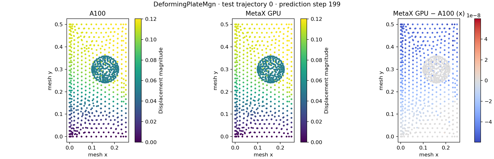

# 沐曦 GPU 运行 PhysicsNeMo Deforming Plate MGN 说明文档

## 一、Deforming Plate MGN 简介

Deforming Plate MGN 是 [PhysicsNeMo v2.0.0](https://github.com/NVIDIA/physicsnemo/tree/v2.0.0/examples/structural_mechanics/deforming_plate) 的板材大变形动力学代理模型，面向 COMSOL 生成的非规则四面体板材网格，使用节点类型、网格几何和当前世界坐标构造 mesh/world 两类边，预测三维位置增量（velocity）及应力。本文使用第二节指定标签的镜像，其中 PhysicsNeMo 版本为 `2.0.0`。

本目录采用文档与容器适配方式，不包含 PhysicsNeMo 源码、DeepMind deforming_plate 的 TFRecord 数据、预处理图数据和训练权重。PhysicsNeMo 使用 DeepMind MeshGraphNets 的 deforming_plate 数据集，通过案例内 `raw_dataset/download_dataset.sh` 获取，再由 `preprocessor.py` 生成训练图；数据说明与获取入口见[PhysicsNeMo 案例](https://github.com/NVIDIA/physicsnemo/tree/v2.0.0/examples/structural_mechanics/deforming_plate)。

## 二、沐曦 GPU 环境配置与运行

### 2.1 环境准备

使用沐曦开发者社区提供的[PhysicsNeMo MACA 镜像](https://developer.metax-tech.com/softnova/docker?chip_name=MXC500&package_name=physicsnemo-maca:2.0.0-3.9.0.12-torch2.8-py312-ubuntu24.04-amd64)启动容器：

```bash
docker run --rm -it \
  --device=/dev/mxcd \
  --device=/dev/dri \
  --group-add video \
  --shm-size=8G \
  --security-opt seccomp=unconfined \
  --ulimit memlock=-1 \
  --ulimit stack=67108864 \
  -v /host_dir:/workspace \
  cr.metax-tech.com/public-ai-release/physicsnemo-maca:2.0.0-3.9.0.12-torch2.8-py312-ubuntu24.04-amd64 \
  /bin/bash
```

**参数说明：**

- `--device=/dev/mxcd --device=/dev/dri`：将沐曦 GPU 设备节点传入容器。
- `--group-add video`：将容器进程加入 `video` 组，以便访问 GPU 设备。
- `--shm-size=8G`：设置共享内存大小，供 PyTorch 和图数据加载使用。
- `--security-opt seccomp=unconfined`：允许 MACA 运行时使用所需的系统调用。
- `--ulimit memlock=-1`：取消内存锁定限制，避免 GPU 运行时申请锁页内存失败。
- `--ulimit stack=67108864`：设置线程栈大小，满足模型和数据处理过程的运行需求。
- `-v /host_dir:/workspace`：挂载工作目录；`/host_dir` 是主机路径，`/workspace` 是容器内路径。

### 2.2 验证环境

进入容器后，先验证沐曦 PyTorch 与 GPU 是否可用：

```bash
python -c "import torch; assert torch.cuda.is_available(); print('PyTorch version:', torch.__version__); print('CUDA OK:', torch.cuda.get_device_name(0))"
```

命令应打印 PyTorch 版本和 `cuda:0` 对应的沐曦 GPU 名称。例如：

```text
PyTorch version: 2.8.0+metax3.9.0.8
CUDA OK: MetaX C500
```

本说明已验证的输出为 `PyTorch version: 2.8.0+metax3.9.0.8`、`CUDA OK: MetaX C500`；实际版本号和设备名称以 PhysicsNeMo MACA 镜像及硬件型号为准。

如果 `torch.cuda.is_available()` 为 `False`，请先检查宿主机驱动、`/dev/mxcd` 和 `/dev/dri` 设备节点挂载、`video` 用户组权限以及容器启动参数，再继续安装 Deforming Plate MGN。

### 2.3 配置 MACA 编译环境

PhysicsNeMo MACA 镜像已配置 MACA 编译环境，并预装沐曦 PyTorch、 PhysicsNeMo 和 Warp；本案例不需要重复安装这些组件。进入容器后可验证：

```bash
python -c "import torch, physicsnemo, warp; assert torch.cuda.is_available(); print('PyTorch:', torch.__version__); print('PhysicsNeMo:', physicsnemo.__version__); print('Warp:', warp.__version__)"
```

命令应输出镜像内各组件的实际版本。例如：

```text
PyTorch: 2.8.0+metax3.9.0.8
PhysicsNeMo: 2.0.0
Warp: 1.12.1
```

### 2.4 安装 Deforming Plate MGN 依赖

推荐使用第四节 Dockerfile 构建的镜像。镜像已包含 PhysicsNeMo 、沐曦 PyTorch 和 Warp。

本案例额外依赖：`tfrecord==1.14.7`、`crc32c==2.8` 用于 TFRecord 数据读取；`tensorboard==2.20.0`、`absl-py==2.3.1`、`grpcio==1.76.0`、`markdown==3.10`、`tensorboard-data-server==0.7.2`、`werkzeug==3.1.3` 支持训练入口的 TensorBoard；`matplotlib==3.10.8`、`contourpy==1.3.3`、`cycler==0.12.1`、`fonttools==4.60.1`、`kiwisolver==1.4.9` 支持推理可视化。镜像原有 PyG、torch_scatter、Apex 与 MACA Transformer Engine 保留。卸载基础镜像中缺少接口的 `flash-attn-3` 后保留 MACA Transformer Engine，不替换沐曦 PyTorch 或 Warp。

对应的安装命令：

```bash
python -m pip uninstall -y flash-attn-3
PYPI_INDEX_URL=http://repo.metax-tech.com/r/pypi/simple
unset HTTP_PROXY HTTPS_PROXY http_proxy https_proxy; \
    python -m pip install --no-cache-dir --no-deps --index-url "${PYPI_INDEX_URL}" --trusted-host repo.metax-tech.com \
    tfrecord==1.14.7 crc32c==2.8 tensorboard==2.20.0 \
    absl-py==2.3.1 grpcio==1.76.0 markdown==3.10 \
    tensorboard-data-server==0.7.2 werkzeug==3.1.3
unset HTTP_PROXY HTTPS_PROXY http_proxy https_proxy; \
    python -m pip install --no-cache-dir --no-deps --index-url "${PYPI_INDEX_URL}" --trusted-host repo.metax-tech.com \
    matplotlib==3.10.8 contourpy==1.3.3 cycler==0.12.1 fonttools==4.60.1 kiwisolver==1.4.9
```

验证依赖：

```bash
cd /root/physicsnemo/examples/structural_mechanics/deforming_plate
python -c "import physicsnemo, warp, torch_scatter, tfrecord, tensorboard; import train, inference, preprocessor; from helpers import add_world_edges; print(physicsnemo.__version__, warp.__version__); print('entry imports PASS')"
```

## 三、运行与验证

### 3.1 数据准备与运行命令

在官方案例目录获取 DeepMind 的 deforming_plate 数据：

```bash
cd /root/physicsnemo/examples/structural_mechanics/deforming_plate/raw_dataset
sh download_dataset.sh deforming_plate
```

返回案例目录，在 `conf/config.yaml` 中核对数据路径，然后预处理、训练并推理：

```bash
cd /root/physicsnemo/examples/structural_mechanics/deforming_plate
python preprocessor.py
python train.py
python inference.py
```

推理读取训练得到的权重，输出滚动预测结果。

### 3.2 扩展训练与推理结果

下图展示两端使用相同训练后权重，对测试轨迹 0 的第 199 步预测位移模长及 x 分量差值；颜色映射到初始网格的 x/y 位置。以 A100 为基准，该轨迹全时段三维位移的整体相对 L2 为 4.46e-7。全部 5 条测试轨迹、各位移分量的全时段相对 L2 最大为 2.31e-3，两端固定权重推理结果接近。



## 四、Dockerfile 构建

本目录提供可直接构建的Dockerfile。Dockerfile 使用上述 PhysicsNeMo MACA 镜像，安装第二节列出的依赖，并在构建时检查 PhysicsNeMo 版本和目标案例入口；构建过程不打包DeepMind deforming_plate 的 TFRecord 数据、预处理图数据和训练权重。

在 `DeformingPlateMgn` 目录执行：

```bash
docker build --build-arg PYPI_INDEX_URL=http://repo.metax-tech.com/r/pypi/simple \
  -t physicsnemo-deforming-plate-mgn-maca:2.0.0-3.9.0.12 .
```

Dockerfile 的 Python 包索引默认使用官方 PyPI；以上命令指定本次已验证的 MetaX 包索引。

构建完成后，使用下列命令启动镜像，并按第三节执行 Deforming Plate MGN 适配验证：

```bash
docker run --rm -it \
  --device=/dev/mxcd \
  --device=/dev/dri \
  --group-add video \
  --shm-size=8G \
  --security-opt seccomp=unconfined \
  --ulimit memlock=-1 \
  --ulimit stack=67108864 \
  -v /host_dir:/workspace \
  physicsnemo-deforming-plate-mgn-maca:2.0.0-3.9.0.12 \
  /bin/bash
```

请将 `/host_dir` 替换为主机侧实际工作目录。第三节小型测试无需外部数据，该挂载用于真实数据及输出。

## 五、其他

1. 开发者在初次使用曦云 GPU 运行 Deforming Plate MGN 时，遵循本手册搭建环境后，可以按照 [PhysicsNeMo Deforming Plate MGN 官网](https://github.com/NVIDIA/physicsnemo/tree/v2.0.0/examples/structural_mechanics/deforming_plate)的教程开展训练及推理。
2. 沐曦仅维护部分 case 的正确性，如出现运行问题，可提交 issue，亦可以在[沐曦开发者社区](https://developer.metax-tech.com)提交 bug 反馈。
3. 了解更多沐曦开源项目，请参考[沐曦开源社区](https://github.com/metax-maca)。

---

本文档仅提供相关软件的配置与使用说明，不包含亦不分发前述软件的源代码或目标代码，且不涉及对其源代码的任何修改。您按照本文档配置、部署或使用相关软件时，应遵守适用许可证规定的条款与条件。相关软件的源代码、许可证全文、版权与归属声明及其他项目文档，请以其官方网站或原始发布页面为准。

Copyright (c) 2026 MetaX Integrated Circuits (Shanghai) Co., Ltd. All rights reserved.
