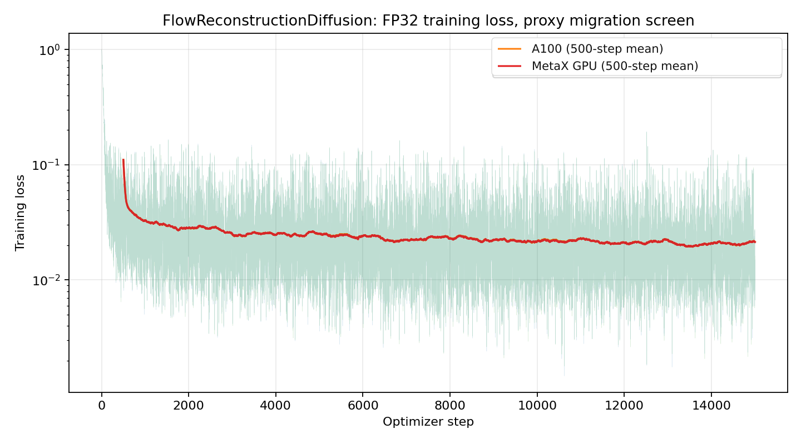
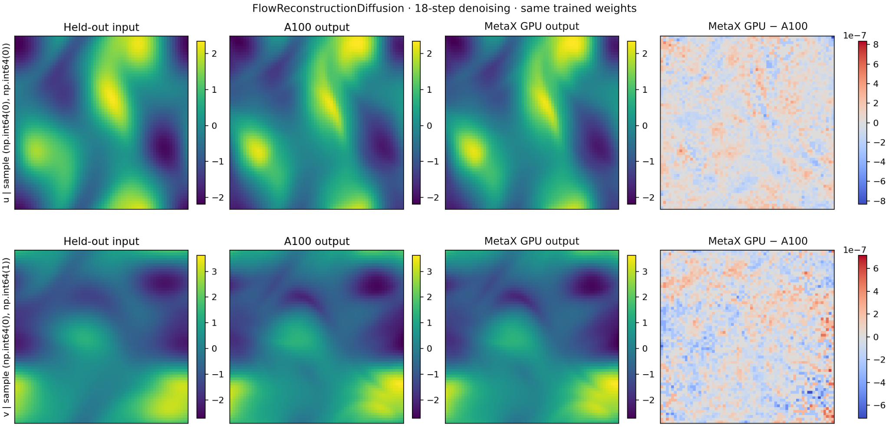

# 沐曦 GPU 运行 PhysicsNeMo Flow Reconstruction Diffusion 说明文档

## 一、Flow Reconstruction Diffusion 简介

Flow Reconstruction Diffusion 是 [PhysicsNeMo v2.0.0](https://github.com/NVIDIA/physicsnemo/tree/v2.0.0/examples/cfd/flow_reconstruction_diffusion) 的二维流场重建与超分辨案例，面向 Kolmogorov 流等低分辨率 CFD 观测，使用扩散模型从稀疏或低分辨率输入重建高分辨率流场。本文档固定使用 PhysicsNeMo 仓库提交 `1ca85d65ac2ce28ea9762910c09a954c08a37140`。

本目录采用文档与容器适配方式，不包含 PhysicsNeMo 源码、Kolmogorov_2D_data 高低分辨率数据和模型权重。PhysicsNeMo 分别提供[高分辨率数据](https://figshare.com/ndownloader/files/39181919)与[随机网格低分辨率观测](https://figshare.com/ndownloader/files/39214622)。

## 二、沐曦 GPU 环境配置与运行

### 2.1 环境准备

使用沐曦开发者社区提供的[PhysicsNeMo MACA 镜像](https://developer.metax-tech.com/softnova/docker?chip_name=MXC500&package_name=physicsnemo-maca:2.0.0-3.9.0.12-torch2.8-py312-ubuntu24.04-amd64)启动容器：

```bash
docker run --rm -it \
  --device=/dev/mxcd \
  --device=/dev/dri \
  --group-add video \
  --shm-size=8G \
  --security-opt seccomp=unconfined \
  --ulimit memlock=-1 \
  --ulimit stack=67108864 \
  -v /host_dir:/workspace \
  cr.metax-tech.com/public-ai-release/physicsnemo-maca:2.0.0-3.9.0.12-torch2.8-py312-ubuntu24.04-amd64 \
  /bin/bash
```

**参数说明：**

- `--device=/dev/mxcd --device=/dev/dri`：将沐曦 GPU 设备节点传入容器。
- `--group-add video`：将容器进程加入 `video` 组，以便访问 GPU 设备。
- `--shm-size=8G`：设置共享内存大小，供 PyTorch 和图数据加载使用。
- `--security-opt seccomp=unconfined`：允许 MACA 运行时使用所需的系统调用。
- `--ulimit memlock=-1`：取消内存锁定限制，避免 GPU 运行时申请锁页内存失败。
- `--ulimit stack=67108864`：设置线程栈大小，满足模型和数据处理过程的运行需求。
- `-v /host_dir:/workspace`：挂载工作目录；`/host_dir` 是主机路径，`/workspace` 是容器内路径。

### 2.2 验证环境

进入容器后，先验证沐曦 PyTorch 与 GPU 是否可用：

```bash
python -c "import torch; assert torch.cuda.is_available(); print('PyTorch version:', torch.__version__); print('CUDA OK:', torch.cuda.get_device_name(0))"
```

命令应打印 PyTorch 版本和 `cuda:0` 对应的沐曦 GPU 名称。例如：

```text
PyTorch version: 2.8.0+metax3.9.0.8
CUDA OK: MetaX GPU
```

实际版本号和设备名称以使用的 PhysicsNeMo MACA 镜像及设备为准。

如果 `torch.cuda.is_available()` 为 `False`，请先检查宿主机驱动、`/dev/mxcd` 和 `/dev/dri` 设备节点挂载、`video` 用户组权限以及容器启动参数，再继续安装 Flow Reconstruction Diffusion。

### 2.3 配置 MACA 编译环境

PhysicsNeMo MACA 镜像已配置 MACA 编译环境，并预装沐曦 PyTorch、 PhysicsNeMo 和 Warp；本案例不需要重复安装这些组件。进入容器后可验证：

```bash
python -c "import torch, physicsnemo, warp; assert torch.cuda.is_available(); print('PyTorch:', torch.__version__); print('PhysicsNeMo:', physicsnemo.__version__); print('Warp:', warp.__version__)"
```

命令应输出：

```text
PyTorch: 2.8.0+metax3.9.0.8
PhysicsNeMo: 2.0.0
Warp: 1.12.1
```

### 2.4 安装 Flow Reconstruction Diffusion 依赖

推荐使用第四节 Dockerfile 构建的镜像。镜像已包含 PhysicsNeMo 、沐曦 PyTorch 和 Warp。

本案例额外依赖：`matplotlib==3.11.2`。Matplotlib 用于案例的结果绘图。

对应的安装命令：

```bash
python -m pip install --no-cache-dir \
    "matplotlib==3.11.2"
```

验证依赖及案例入口（在交付镜像的默认工作目录执行）：

```bash
python -c 'import physicsnemo, torch, warp; assert physicsnemo.__version__ == "2.0.0"; print(physicsnemo.__version__, torch.__version__, warp.__version__)'
python -c 'import pathlib, runpy, sys; p=pathlib.Path("train.py"); sys.path.insert(0, str(p.parent.resolve())); runpy.run_path(str(p))'
```

## 三、运行与验证

### 3.1 数据准备、训练与推理

官方案例提供 [高分辨率数据](https://figshare.com/ndownloader/files/39181919) 和 [低分辨率观测数据](https://figshare.com/ndownloader/files/39214622)。在 PhysicsNeMo 源码目录准备数据：

```bash
cd examples/cfd/flow_reconstruction_diffusion
mkdir -p Kolmogorov_2D_data
wget -O Kolmogorov_2D_data/kf_2d_re1000_256_40seed.npy https://figshare.com/ndownloader/files/39181919
wget -O Kolmogorov_2D_data/kmflow_sampled_data_irregnew.npz https://figshare.com/ndownloader/files/39214622
```

在 `conf/config_dfsr_train.yaml` 和 `conf/config_dfsr_generate.yaml` 中分别设置数据、采样数据和检查点路径后，使用官方训练和生成入口：

```bash
python train.py --config-name=config_dfsr_train
python train.py --config-name=config_dfsr_generate
```

以下对比使用外部 Kolmogorov 流代理数据：将速度分量分别作为标量序列，并以连续三帧构成模型输入。A100 与 MetaX GPU 使用相同初始权重、训练样本顺序和 FP32 设置，各训练 15,000 步；推理对 8 个留出输入执行 18 步去噪。该数据映射与训练目标采用本次验证配置。

### 3.2 训练与推理结果

下图展示 A100 与 MetaX GPU 的训练 Loss，曲线为 500 步滑动均值，两端变化趋势基本一致。



下图展示相同训练后模型权重下，留出样本的两个速度分量经 18 步去噪后的推理结果和设备间差值。以 A100 输出为基准，8 个输入的整体相对 L2 为 `1.72e-7`，两端推理结果基本一致。



## 四、Dockerfile 构建

本目录提供可直接构建的 Dockerfile。Dockerfile 使用上述 PhysicsNeMo MACA 镜像，安装第二节列出的本案例依赖，并在构建时核对 PhysicsNeMo v2.0.0 和 `train.py` 案例入口；构建过程不打包 Kolmogorov_2D_data 高低分辨率数据和模型权重。

在 `FlowReconstructionDiffusion` 目录执行：

```bash
docker build -t physicsnemo-flowreconstructiondiffusion:2.0.0-maca .
```

构建完成后，使用下列命令启动镜像：

```bash
docker run --rm -it \
  --device=/dev/mxcd \
  --device=/dev/dri \
  --group-add video \
  --shm-size=8G \
  --security-opt seccomp=unconfined \
  --ulimit memlock=-1 \
  --ulimit stack=67108864 \
  -v /host_dir:/workspace \
  physicsnemo-flowreconstructiondiffusion:2.0.0-maca \
  /bin/bash
```

请将 `/host_dir` 替换为主机侧实际工作目录。该挂载用于访问使用者的数据和输出。

## 五、其他

1. 开发者在初次使用曦云 GPU 运行 Flow Reconstruction Diffusion 时，遵循本手册搭建环境后，可以按照 [PhysicsNeMo Flow Reconstruction Diffusion 官网](https://github.com/NVIDIA/physicsnemo/tree/v2.0.0/examples/cfd/flow_reconstruction_diffusion)的教程开展训练及推理。
2. 沐曦仅维护部分 case 的正确性，如出现运行问题，可提交 issue，亦可以在[沐曦开发者社区](https://developer.metax-tech.com)提交 bug 反馈。
3. 了解更多沐曦开源项目，请参考[沐曦开源社区](https://github.com/metax-maca)。

---

本文档仅提供相关软件的配置与使用说明，不包含亦不分发前述软件的源代码或目标代码，且不涉及对其源代码的任何修改。您按照本文档配置、部署或使用相关软件时，应遵守适用许可证规定的条款与条件。相关软件的源代码、许可证全文、版权与归属声明及其他项目文档，请以其官方网站或原始发布页面为准。

Copyright (c) 2026 MetaX Integrated Circuits (Shanghai) Co., Ltd. All rights reserved.
