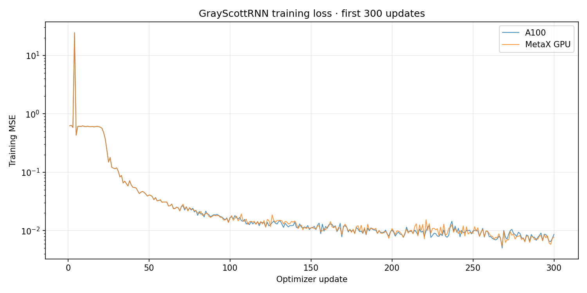
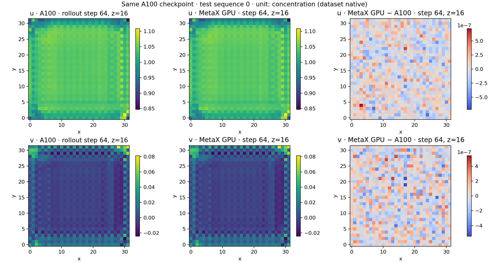

# 沐曦 GPU 运行 PhysicsNeMo Gray Scott RNN 说明文档

## 一、Gray Scott RNN 简介

Gray Scott RNN 是 [PhysicsNeMo v2.0.0](https://github.com/NVIDIA/physicsnemo/tree/v2.0.0/examples/cfd/gray_scott_rnn) 的三维 Gray-Scott 反应扩散系统的时序预测案例，面向不同初始条件下的三维浓度场，使用初始状态预测后续时间步的状态场。本文档固定使用 PhysicsNeMo 仓库提交 `1ca85d65ac2ce28ea9762910c09a954c08a37140`。

本目录采用文档与容器适配方式，不包含 PhysicsNeMo 源码、Gray-Scott 时序数据和模型权重。PhysicsNeMo `gray_scott_rnn.py` 含数据下载与预处理逻辑，数据来源及使用说明见[PhysicsNeMo 案例](https://github.com/NVIDIA/physicsnemo/tree/v2.0.0/examples/cfd/gray_scott_rnn)。

## 二、沐曦 GPU 环境配置与运行

### 2.1 环境准备

使用沐曦开发者社区提供的[PhysicsNeMo MACA 镜像](https://developer.metax-tech.com/softnova/docker?chip_name=MXC500&package_name=physicsnemo-maca:2.0.0-3.9.0.12-torch2.8-py312-ubuntu24.04-amd64)启动容器：

```bash
docker run --rm -it \
  --device=/dev/mxcd \
  --device=/dev/dri \
  --group-add video \
  --shm-size=8G \
  --security-opt seccomp=unconfined \
  --ulimit memlock=-1 \
  --ulimit stack=67108864 \
  -v /host_dir:/workspace \
  cr.metax-tech.com/public-ai-release/physicsnemo-maca:2.0.0-3.9.0.12-torch2.8-py312-ubuntu24.04-amd64 \
  /bin/bash
```

**参数说明：**

- `--device=/dev/mxcd --device=/dev/dri`：将沐曦 GPU 设备节点传入容器。
- `--group-add video`：将容器进程加入 `video` 组，以便访问 GPU 设备。
- `--shm-size=8G`：设置共享内存大小，供 PyTorch 和图数据加载使用。
- `--security-opt seccomp=unconfined`：允许 MACA 运行时使用所需的系统调用。
- `--ulimit memlock=-1`：取消内存锁定限制，避免 GPU 运行时申请锁页内存失败。
- `--ulimit stack=67108864`：设置线程栈大小，满足模型和数据处理过程的运行需求。
- `-v /host_dir:/workspace`：挂载工作目录；`/host_dir` 是主机路径，`/workspace` 是容器内路径。

### 2.2 验证环境

进入容器后，先验证沐曦 PyTorch 与 GPU 是否可用：

```bash
python -c "import torch; assert torch.cuda.is_available(); print('PyTorch version:', torch.__version__); print('CUDA OK:', torch.cuda.get_device_name(0))"
```

命令应打印 PyTorch 版本和 `cuda:0` 对应的沐曦 GPU 名称。例如：

```text
PyTorch version: 2.8.0+metax3.9.0.8
CUDA OK: MetaX GPU
```

实际版本号和设备名称以使用的 PhysicsNeMo MACA 镜像及设备为准。

如果 `torch.cuda.is_available()` 为 `False`，请先检查宿主机驱动、`/dev/mxcd` 和 `/dev/dri` 设备节点挂载、`video` 用户组权限以及容器启动参数，再继续安装 Gray Scott RNN。

### 2.3 配置 MACA 编译环境

PhysicsNeMo MACA 镜像已配置 MACA 编译环境，并预装沐曦 PyTorch、 PhysicsNeMo 和 Warp；本案例不需要重复安装这些组件。进入容器后可验证：

```bash
python -c "import torch, physicsnemo, warp; assert torch.cuda.is_available(); print('PyTorch:', torch.__version__); print('PhysicsNeMo:', physicsnemo.__version__); print('Warp:', warp.__version__)"
```

命令应输出：

```text
PyTorch: 2.8.0+metax3.9.0.8
PhysicsNeMo: 2.0.0
Warp: 1.12.1
```

### 2.4 安装 Gray Scott RNN 依赖

推荐使用第四节 Dockerfile 构建的镜像。镜像已包含 PhysicsNeMo 、沐曦 PyTorch 和 Warp。

本案例额外依赖：`pyvista==0.49.2`、`vtk==9.7.2`。PyVista/VTK 用于三维场数据处理和可视化。

对应的安装命令：

```bash
PYPI_INDEX_URL=https://pypi.tuna.tsinghua.edu.cn/simple
python -m pip install --no-cache-dir --index-url="$PYPI_INDEX_URL" \
    "vtk==9.7.2" "pyvista==0.49.2"
```

验证依赖及案例入口（在交付镜像的默认工作目录执行）：

```bash
python -c 'import physicsnemo, torch, warp; assert physicsnemo.__version__ == "2.0.0"; print(physicsnemo.__version__, torch.__version__, warp.__version__)'
python -c 'import pathlib, runpy, sys; p=pathlib.Path("gray_scott_rnn.py"); sys.path.insert(0, str(p.parent.resolve())); runpy.run_path(str(p))'
```

## 三、运行与验证

### 3.1 数据准备与运行命令

官方入口在数据不存在时自动从 Zenodo 下载并解压训练集和测试集。也可在训练前手动准备：

```bash
cd /root/physicsnemo/examples/cfd/gray_scott_rnn
mkdir -p datasets
wget -O datasets/grayscott_training.tar.gz 'https://zenodo.org/record/5148524/files/grayscott_training.tar.gz'
wget -O datasets/grayscott_test.tar.gz 'https://zenodo.org/record/5148524/files/grayscott_test.tar.gz'
tar -xzf datasets/grayscott_training.tar.gz -C datasets
tar -xzf datasets/grayscott_test.tar.gz -C datasets
```

确认 `datasets/grayscott_training.hdf5` 和 `datasets/grayscott_test.hdf5` 就绪后，运行官方入口：

```bash
python gray_scott_rnn.py
```

入口会预处理数据，并在训练期间执行验证推理；训练配置位于 `conf/config_3d.yaml`。

### 3.2 训练与推理结果

采用 One2ManyRNN、FP32 和随机种子 17。两端使用相同的模型权重，对一条测试序列的输入帧滚动预测 64 步。

下图比较两端训练前 300 次优化更新的逐步 MSE，曲线变化趋势基本一致；以 A100 为基线，逐步相对差异的平均值为 6.34%。



下图展示两端使用相同的模型权重时，第 64 个预测步的 `u`、`v` 浓度场中间切片及差值。以 A100 为基线，对 64 步完整三维输出计算，`u` 和 `v` 的相对 L2 分别为 1.75e-7 和 2.29e-6；两端相同权重下的推理结果基本一致。



## 四、Dockerfile 构建

本目录提供可直接构建的 Dockerfile。Dockerfile 使用上述 PhysicsNeMo MACA 镜像，安装第二节列出的本案例依赖，并在构建时核对 PhysicsNeMo v2.0.0 和 `gray_scott_rnn.py` 案例入口；构建过程不打包 Gray-Scott 时序数据和模型权重。

在 `GrayScottRNN` 目录执行：

```bash
docker build --build-arg PYPI_INDEX_URL=https://pypi.tuna.tsinghua.edu.cn/simple -t physicsnemo-grayscottrnn:2.0.0-maca .
```

构建完成后，使用下列命令启动镜像：

```bash
docker run --rm -it \
  --device=/dev/mxcd \
  --device=/dev/dri \
  --group-add video \
  --shm-size=8G \
  --security-opt seccomp=unconfined \
  --ulimit memlock=-1 \
  --ulimit stack=67108864 \
  -v /host_dir:/workspace \
  physicsnemo-grayscottrnn:2.0.0-maca \
  /bin/bash
```

请将 `/host_dir` 替换为主机侧实际工作目录。该挂载用于访问使用者的数据和输出。

## 五、其他

1. 开发者在初次使用曦云 GPU 运行 Gray Scott RNN 时，遵循本手册搭建环境后，可以按照 [PhysicsNeMo Gray Scott RNN 官网](https://github.com/NVIDIA/physicsnemo/tree/v2.0.0/examples/cfd/gray_scott_rnn)的教程开展训练及推理。
2. 沐曦仅维护部分 case 的正确性，如出现运行问题，可提交 issue，亦可以在[沐曦开发者社区](https://developer.metax-tech.com)提交 bug 反馈。
3. 了解更多沐曦开源项目，请参考[沐曦开源社区](https://github.com/metax-maca)。

---

本文档仅提供相关软件的配置与使用说明，不包含亦不分发前述软件的源代码或目标代码，且不涉及对其源代码的任何修改。您按照本文档配置、部署或使用相关软件时，应遵守适用许可证规定的条款与条件。相关软件的源代码、许可证全文、版权与归属声明及其他项目文档，请以其官方网站或原始发布页面为准。

Copyright (c) 2026 MetaX Integrated Circuits (Shanghai) Co., Ltd. All rights reserved.
