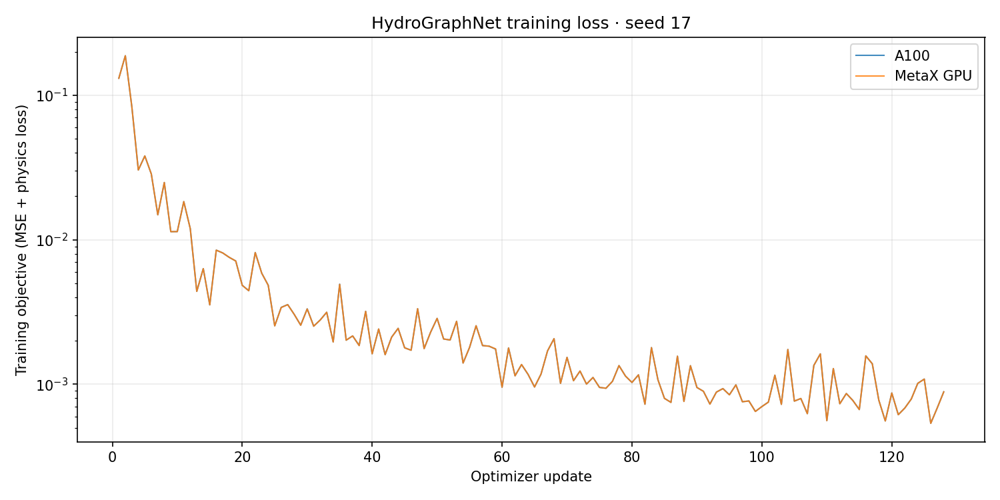
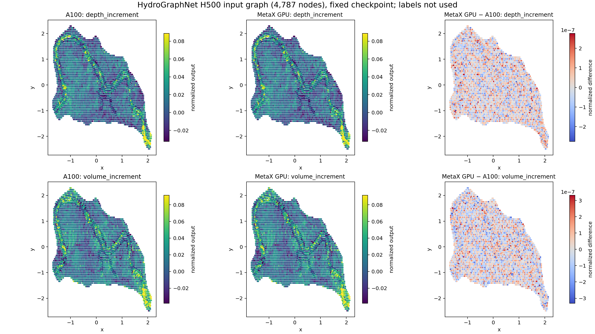

# 沐曦 GPU 运行 PhysicsNeMo HydroGraphNet 说明文档

## 一、 PhysicsNeMo HydroGraphNet 简介

HydroGraphNet 面向洪水演进预测，以非结构网格上的节点与边水文特征为输入，预测节点水深和水量变化。本文档使用案例配置中的 16 维节点输入、3 维边输入和 2 维输出验证 MeshGraphKAN。PhysicsNeMo v2.0.0 tag 经核对对应提交 SHA `1ca85d65ac2ce28ea9762910c09a954c08a37140`。

本目录仅提供 Dockerfile、LICENSE 和本说明，不包含 PhysicsNeMo 源码、训练数据或模型权重。PhysicsNeMo 案例以印第安纳州 Muncie 附近的 White River 洪水为例，包含网格、边界入流和高保真 HEC-RAS 水深/水量结果；数据可由案例数据集从 [Zenodo 14969507](https://zenodo.org/record/14969507) 获取。详见[PhysicsNeMo HydroGraphNet 说明](https://github.com/NVIDIA/physicsnemo/tree/v2.0.0/examples/weather/flood_modeling/hydrographnet)。

## 二、沐曦 GPU 环境配置与运行

### 2.1 环境准备

使用沐曦开发者社区提供的[PhysicsNeMo MACA 镜像](https://developer.metax-tech.com/softnova/docker?chip_name=MXC500&package_name=physicsnemo-maca:2.0.0-3.9.0.12-torch2.8-py312-ubuntu24.04-amd64)启动容器：

```bash
docker run --rm -it \
  --device=/dev/mxcd \
  --device=/dev/dri \
  --group-add video \
  --shm-size=8G \
  --security-opt seccomp=unconfined \
  --ulimit memlock=-1 \
  --ulimit stack=67108864 \
  -v /host_dir:/workspace \
  cr.metax-tech.com/public-ai-release/physicsnemo-maca:2.0.0-3.9.0.12-torch2.8-py312-ubuntu24.04-amd64 \
  /bin/bash
```

**参数说明：**

- `--device=/dev/mxcd --device=/dev/dri`：将沐曦 GPU 设备节点传入容器。
- `--group-add video`：将容器进程加入 `video` 组，以便访问 GPU 设备。
- `--shm-size=8G`：设置共享内存大小，供 PyTorch 和图数据加载使用。
- `--security-opt seccomp=unconfined`：允许 MACA 运行时使用所需的系统调用。
- `--ulimit memlock=-1`：取消内存锁定限制，避免 GPU 运行时申请锁页内存失败。
- `--ulimit stack=67108864`：设置线程栈大小，满足模型和数据处理过程的运行需求。
- `-v /host_dir:/workspace`：挂载工作目录；`/host_dir` 是主机路径，`/workspace` 是容器内路径。

### 2.2 验证环境

进入容器后，先验证沐曦 PyTorch 与 GPU 是否可用：

```bash
python -c "import torch; assert torch.cuda.is_available(); print('PyTorch version:', torch.__version__); print('CUDA OK:', torch.cuda.get_device_name(0))"
```

示例输出：

```text
PyTorch version: 2.8.0+metax3.9.0.8
CUDA OK: MetaX GPU
```

如果 `torch.cuda.is_available()` 为 `False`，请检查宿主机驱动、`/dev/mxcd` 和 `/dev/dri` 设备节点挂载、`video` 用户组权限以及容器启动参数，再继续安装该案例。

### 2.3 配置 MACA 编译环境

PhysicsNeMo MACA 镜像已配置 MACA 编译环境，并预装沐曦 PyTorch、 PhysicsNeMo 和 Warp；本案例不需要重复安装这些组件。进入容器后可验证：

```bash
python -c "import torch, physicsnemo, warp; assert torch.cuda.is_available(); print('PyTorch:', torch.__version__); print('PhysicsNeMo:', physicsnemo.__version__); print('Warp:', warp.__version__)"
```

示例输出：

```text
PyTorch: 2.8.0+metax3.9.0.8
PhysicsNeMo: 2.0.0
Warp: 1.12.1
```


### 2.4 安装 HydroGraphNet 依赖

推荐使用第四节 Dockerfile 构建的镜像。镜像已包含 PhysicsNeMo 、沐曦 PyTorch 和 Warp。

PhysicsNeMo `requirements.txt` 约束 `mlflow>=2.1.1`、`termcolor>=2.1.1`、`torch_geometric>=2.6.1`、`torch_scatter>=2.1.2`，并安装 `hydra-core` 与 `wandb`。

对应的安装命令：

```bash
python -m pip install --index-url=https://pypi.tuna.tsinghua.edu.cn/simple -r /root/physicsnemo/examples/weather/flood_modeling/hydrographnet/requirements.txt
```

验证依赖：

```bash
cd /root/physicsnemo/examples/weather/flood_modeling/hydrographnet
python train.py --help
```

## 三、运行与验证

### 3.1 数据准备与运行命令

官方 `HydroGraphDataset` 在指定数据目录不存在时，从 [Zenodo 14969507](https://zenodo.org/record/14969507) 下载并解压数据。可在训练前使用官方数据准备入口：

```bash
cd /root/physicsnemo/examples/weather/flood_modeling/hydrographnet
python -c "from physicsnemo.datapipes.gnn.hydrographnet_dataset import ensure_data_available; ensure_data_available('/workspace/hydrographnet-data')"
```

在 `conf/config.yaml` 中将 `data_dir` 配置为实际数据目录；为推理准备测试数据及 ID 列表，并设置 `test_dir` 和检查点路径。进入官方案例目录运行训练和推理：

```bash
python train.py --config-path conf --config-name config
python inference.py --config-path conf --config-name config
```

官方推理输出测试样本的预测动画。

### 3.2 训练与推理结果

以 FP32、随机种子 17 和相同初始权重，A100 与 MetaX GPU 使用 128 条不同训练水文过程各执行 128 次更新。推理使用另行保留的 H500 输入图，包含 4,787 个节点；本次留出方式用于跨设备验证。

下图比较两端逐步训练目标，包括 MSE 和物理约束 Loss。两条曲线整体下降且变化趋势基本一致，末 20 次更新平均目标相对 A100 的差异为 0.0289%。



下图展示两端使用相同的模型权重时，H500 图节点的水深变化量和水量变化量预测及差值。以 A100 输出为基线，两个通道的相对 L2 分别为 3.87e-6 和 4.32e-6；两端相同权重下的推理结果基本一致。



## 四、Dockerfile 构建

本目录提供可直接构建的 Dockerfile。Dockerfile 以 `cr.metax-tech.com/public-ai-release/physicsnemo-maca:2.0.0-3.9.0.12-torch2.8-py312-ubuntu24.04-amd64` 为基础，移除基础镜像中不兼容的 `flash-attn-3`，安装本节列出的额外依赖，并在构建时导入 MeshGraphKAN 与图依赖，并运行 `train.py --help`。构建上下文为本模型目录；镜像不打包 PhysicsNeMo 源码、训练数据和模型权重。

在 `HydroGraphNet` 目录执行：

```bash
unset no_proxy https_proxy NO_PROXY HTTPS_PROXY HTTP_PROXY http_proxy
docker build --network=host --build-arg PYPI_INDEX_URL=https://pypi.tuna.tsinghua.edu.cn/simple -t physicsnemo-hydrographnet:c500 .
```

构建完成后，使用下列命令启动镜像：

```bash
docker run --rm -it \
  --device=/dev/mxcd \
  --device=/dev/dri \
  --group-add video \
  --shm-size=8G \
  --security-opt seccomp=unconfined \
  --ulimit memlock=-1 \
  --ulimit stack=67108864 \
  -v /host_dir:/workspace \
  physicsnemo-hydrographnet:c500 \
  /bin/bash
```

请将 `/host_dir` 替换为主机侧实际工作目录；此挂载用于放置数据和保存输出。

## 五、其他

1. 开发者在初次使用曦云 GPU 运行 HydroGraphNet 时，遵循本手册搭建环境后，可以按照 [PhysicsNeMo HydroGraphNet 官网](https://github.com/NVIDIA/physicsnemo/tree/v2.0.0/examples/weather/flood_modeling/hydrographnet)的教程开展训练及推理。
2. 沐曦仅维护部分 case 的正确性，如出现运行问题，可提交 issue，亦可以在[沐曦开发者社区](https://developer.metax-tech.com)提交 bug 反馈。
3. 了解更多沐曦开源项目，请参考[沐曦开源社区](https://github.com/metax-maca)。

---

本文档仅提供相关软件的配置与使用说明，不包含亦不分发前述软件的源代码或目标代码，且不涉及对其源代码的任何修改。您按照本文档配置、部署或使用相关软件时，应遵守适用许可证规定的条款与条件。相关软件的源代码、许可证全文、版权与归属声明及其他项目文档，请以其官方网站或原始发布页面为准。

Copyright (c) 2026 MetaX Integrated Circuits (Shanghai) Co., Ltd. All rights reserved.
