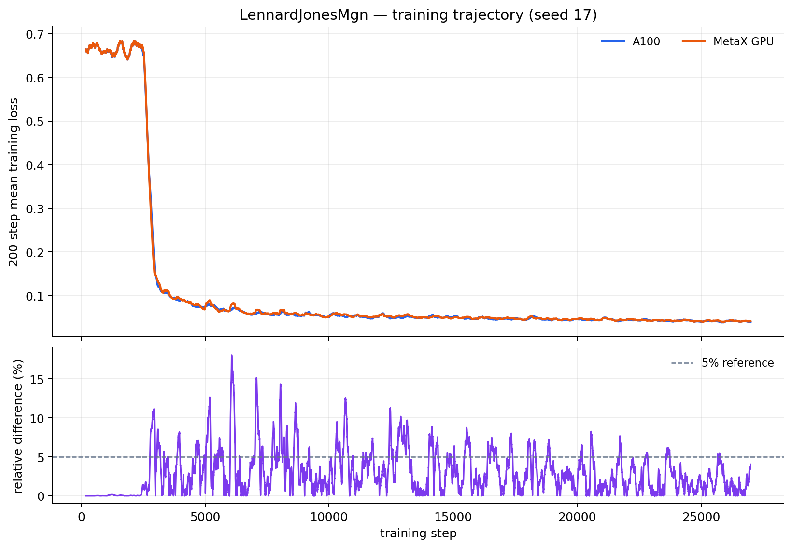
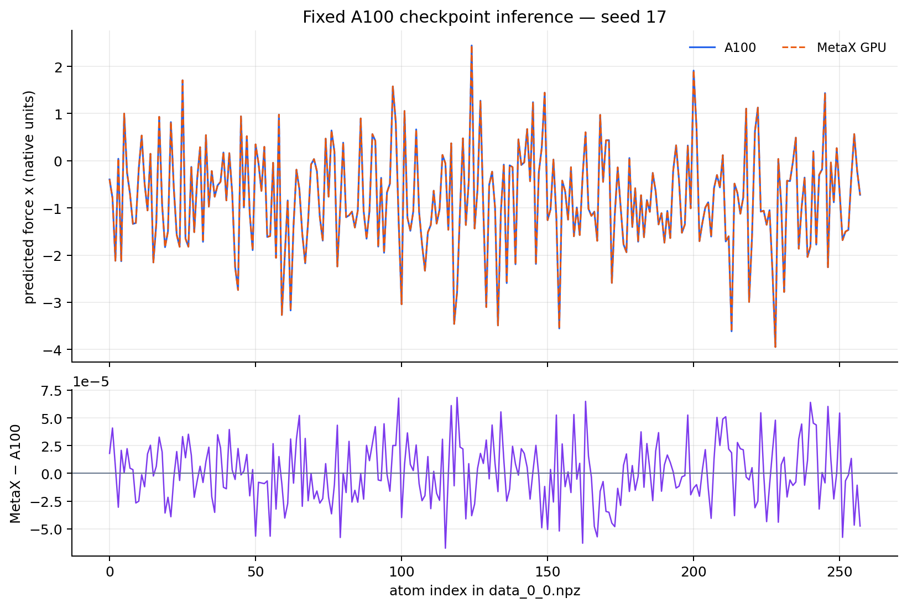

# 沐曦 GPU 运行 PhysicsNeMo Lennard-Jones MGN 说明文档

## 一、Lennard-Jones MGN 简介

Lennard-Jones MGN 是 [PhysicsNeMo v2.0.0](https://github.com/NVIDIA/physicsnemo/tree/v2.0.0/examples/molecular_dynamics/lennard_jones) 的液态氩 Lennard-Jones 分子动力学图模型，使用原子位置和周期边界下的相对方向、距离构造近邻图，预测每个原子的三维力。本文使用第二节指定标签的镜像，其中 PhysicsNeMo 版本为 `2.0.0`。

本目录采用文档与容器适配方式，不包含 PhysicsNeMo 源码、OpenMM 生成的液态氩训练数据和模型权重。PhysicsNeMo 数据说明为258原子体系的10000个样本，`download_data.py` 从 Google Drive 下载现成压缩包；该脚本下载原始数据，不生成分子动力学数据。数据与原始工作的说明见[PhysicsNeMo 案例](https://github.com/NVIDIA/physicsnemo/tree/v2.0.0/examples/molecular_dynamics/lennard_jones)。

## 二、沐曦 GPU 环境配置与运行

### 2.1 环境准备

使用沐曦开发者社区提供的[PhysicsNeMo MACA 镜像](https://developer.metax-tech.com/softnova/docker?chip_name=MXC500&package_name=physicsnemo-maca:2.0.0-3.9.0.12-torch2.8-py312-ubuntu24.04-amd64)启动容器：

```bash
docker run --rm -it \
  --device=/dev/mxcd \
  --device=/dev/dri \
  --group-add video \
  --shm-size=8G \
  --security-opt seccomp=unconfined \
  --ulimit memlock=-1 \
  --ulimit stack=67108864 \
  -v /host_dir:/workspace \
  cr.metax-tech.com/public-ai-release/physicsnemo-maca:2.0.0-3.9.0.12-torch2.8-py312-ubuntu24.04-amd64 \
  /bin/bash
```

**参数说明：**

- `--device=/dev/mxcd --device=/dev/dri`：将沐曦 GPU 设备节点传入容器。
- `--group-add video`：将容器进程加入 `video` 组，以便访问 GPU 设备。
- `--shm-size=8G`：设置共享内存大小，供 PyTorch 和图数据加载使用。
- `--security-opt seccomp=unconfined`：允许 MACA 运行时使用所需的系统调用。
- `--ulimit memlock=-1`：取消内存锁定限制，避免 GPU 运行时申请锁页内存失败。
- `--ulimit stack=67108864`：设置线程栈大小，满足模型和数据处理过程的运行需求。
- `-v /host_dir:/workspace`：挂载工作目录；`/host_dir` 是主机路径，`/workspace` 是容器内路径。

### 2.2 验证环境

进入容器后，先验证沐曦 PyTorch 与 GPU 是否可用：

```bash
python -c "import torch; assert torch.cuda.is_available(); print('PyTorch version:', torch.__version__); print('CUDA OK:', torch.cuda.get_device_name(0))"
```

命令应打印 PyTorch 版本和 `cuda:0` 对应的沐曦 GPU 名称。例如：

```text
PyTorch version: 2.8.0+metax3.9.0.8
CUDA OK: MetaX GPU
```

实际版本号和设备名称以使用的 PhysicsNeMo MACA 镜像及设备为准。

如果 `torch.cuda.is_available()` 为 `False`，请先检查宿主机驱动、`/dev/mxcd` 和 `/dev/dri` 设备节点挂载、`video` 用户组权限以及容器启动参数，再继续安装 Lennard-Jones MGN。

### 2.3 配置 MACA 编译环境

PhysicsNeMo MACA 镜像已配置 MACA 编译环境，并预装沐曦 PyTorch、 PhysicsNeMo 和 Warp；本案例不需要重复安装这些组件。进入容器后可验证：

```bash
python -c "import torch, physicsnemo, warp; assert torch.cuda.is_available(); print('PyTorch:', torch.__version__); print('PhysicsNeMo:', physicsnemo.__version__); print('Warp:', warp.__version__)"
```

命令应输出镜像内各组件的实际版本。例如：

```text
PyTorch: 2.8.0+metax3.9.0.8
PhysicsNeMo: 2.0.0
Warp: 1.12.1
```

### 2.4 安装 Lennard-Jones MGN 依赖

推荐使用第四节 Dockerfile 构建的镜像。镜像已包含 PhysicsNeMo 、沐曦 PyTorch 和 Warp。

本案例额外依赖：`matplotlib==3.10.8`、`contourpy==1.3.3`、`cycler==0.12.1`、`fonttools==4.60.1`、`kiwisolver==1.4.9` 支持训练入口绘图；`gdown==5.2.0`、`beautifulsoup4==4.13.4`、`soupsieve==2.7` 支持 PhysicsNeMo 数据下载工具。镜像原有 SciPy、PyG、torch_scatter 与 MACA Transformer Engine 保留。卸载基础镜像中缺少接口的 `flash-attn-3` 后保留 MACA Transformer Engine，不替换沐曦 PyTorch 或 Warp。

对应的安装命令：

```bash
python -m pip uninstall -y flash-attn-3
PYPI_INDEX_URL=http://repo.metax-tech.com/r/pypi/simple
unset HTTP_PROXY HTTPS_PROXY http_proxy https_proxy; \
    python -m pip install --no-cache-dir --no-deps --index-url "${PYPI_INDEX_URL}" --trusted-host repo.metax-tech.com \
    matplotlib==3.10.8 contourpy==1.3.3 cycler==0.12.1 fonttools==4.60.1 kiwisolver==1.4.9
unset HTTP_PROXY HTTPS_PROXY http_proxy https_proxy; \
    python -m pip install --no-cache-dir --no-deps --index-url "${PYPI_INDEX_URL}" --trusted-host repo.metax-tech.com \
    gdown==5.2.0 beautifulsoup4==4.13.4 soupsieve==2.7
```

验证依赖：

```bash
cd /root/physicsnemo/examples/molecular_dynamics/lennard_jones
python -c "import physicsnemo, warp, torch_scatter, gdown; import lennard_jones_system, utils; print(physicsnemo.__version__, warp.__version__); print('entry imports PASS')"
```

## 三、运行与验证

### 3.1 训练与验证推理命令

#### 数据准备

在官方案例目录运行下载脚本，从 Google Drive 获取并解压液态氩数据：

```bash
cd /root/physicsnemo/examples/molecular_dynamics/lennard_jones
python download_data.py
```

脚本将压缩包下载到当前目录并解压；训练入口读取案例目录下的 `lj_data`。


在 Lennard-Jones 案例目录准备好 `lj_data` 数据后，执行官方训练入口：

```bash
cd /root/physicsnemo/examples/molecular_dynamics/lennard_jones
python lennard_jones_system.py
```

该入口在每个训练 epoch 后自动使用测试数据进行验证推理，并保存检查点和结果图；配置位于 `conf/config.yaml`。再次运行时会尝试加载已有检查点。

训练与验证推理使用同一条命令；官方案例没有独立的推理入口。

### 3.2 训练与推理结果

使用液态氩 Lennard-Jones 数据，选取 8,000 个训练样本、64 个留出样本，固定随机种子为 17。A100 与 MetaX GPU 从相同初始权重出发，以 FP32 分别训练 27,000 步，采用相同数据顺序和训练配置。

下图对比两端的训练 Loss，曲线为 200 步滑动均值，下方展示相对 A100 的差异。两端 Loss 整体下降，滑动均值的平均相对差异为 2.92%，变化趋势基本一致。



下图展示两端使用相同的训练后模型权重时，留出样本中各原子 x 方向力的预测及其差值。以 A100 为基线，在全部 64 个留出样本的三维力预测上计算的相对 L2 为 9.85e-7，两端推理结果整体接近。



## 四、Dockerfile 构建

本目录提供可直接构建的Dockerfile。Dockerfile 使用上述 PhysicsNeMo MACA 镜像，安装第二节列出的依赖，并在构建时检查 PhysicsNeMo 版本和目标案例入口；构建过程不打包OpenMM 生成的液态氩训练数据和模型权重。

在 `LennardJonesMgn` 目录执行：

```bash
docker build --build-arg PYPI_INDEX_URL=http://repo.metax-tech.com/r/pypi/simple \
  -t physicsnemo-lennard-jones-mgn-maca:2.0.0-3.9.0.12 .
```

Dockerfile 的 Python 包索引默认使用官方 PyPI；以上命令指定示例中的 MetaX 包索引。

构建完成后，使用下列命令启动镜像：

```bash
docker run --rm -it \
  --device=/dev/mxcd \
  --device=/dev/dri \
  --group-add video \
  --shm-size=8G \
  --security-opt seccomp=unconfined \
  --ulimit memlock=-1 \
  --ulimit stack=67108864 \
  -v /host_dir:/workspace \
  physicsnemo-lennard-jones-mgn-maca:2.0.0-3.9.0.12 \
  /bin/bash
```

请将 `/host_dir` 替换为主机侧实际工作目录。该挂载用于数据及输出。

## 五、其他

1. 开发者在初次使用曦云 GPU 运行 Lennard-Jones MGN 时，遵循本手册搭建环境后，可以按照 [PhysicsNeMo Lennard-Jones MGN 官网](https://github.com/NVIDIA/physicsnemo/tree/v2.0.0/examples/molecular_dynamics/lennard_jones)的教程开展训练及推理。
2. 沐曦仅维护部分 case 的正确性，如出现运行问题，可提交 issue，亦可以在[沐曦开发者社区](https://developer.metax-tech.com)提交 bug 反馈。
3. 了解更多沐曦开源项目，请参考[沐曦开源社区](https://github.com/metax-maca)。

---

本文档仅提供相关软件的配置与使用说明，不包含亦不分发前述软件的源代码或目标代码，且不涉及对其源代码的任何修改。您按照本文档配置、部署或使用相关软件时，应遵守适用许可证规定的条款与条件。相关软件的源代码、许可证全文、版权与归属声明及其他项目文档，请以其官方网站或原始发布页面为准。

Copyright (c) 2026 MetaX Integrated Circuits (Shanghai) Co., Ltd. All rights reserved.
