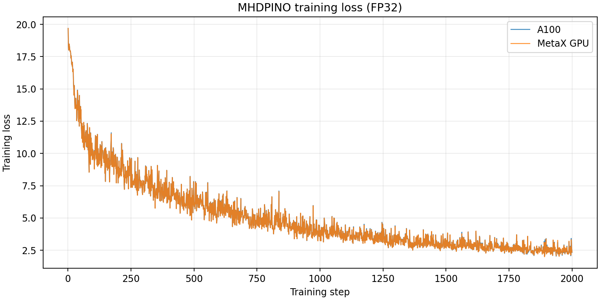
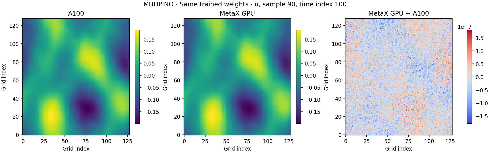

# 沐曦 GPU 运行 PhysicsNeMo MHD PINO 说明文档

## 一、MHD PINO 简介

MHD PINO 是 [PhysicsNeMo v2.0.0](https://github.com/NVIDIA/physicsnemo/tree/v2.0.0/examples/cfd/mhd_pino) 的不可压缩磁流体动力学的物理约束神经算子案例，面向流体速度场与磁场耦合演化，使用场变量预测后续时空状态并通过方程残差约束模型。本文档固定使用 PhysicsNeMo 仓库提交 `1ca85d65ac2ce28ea9762910c09a954c08a37140`。

本目录采用文档与容器适配方式，不包含 PhysicsNeMo 源码、MHD 训练与验证数据及模型权重。MHD 数据生成代码见 [MHD PINO 仓库](https://github.com/shawnrosofsky/mhd_pino/tree/master)，生成数据需 Dedalus；本目录不包含 Dedalus 或生成的数据。

## 二、沐曦 GPU 环境配置与运行

### 2.1 环境准备

使用沐曦开发者社区提供的[PhysicsNeMo MACA 镜像](https://developer.metax-tech.com/softnova/docker?chip_name=MXC500&package_name=physicsnemo-maca:2.0.0-3.9.0.12-torch2.8-py312-ubuntu24.04-amd64)启动容器：

```bash
docker run --rm -it \
  --device=/dev/mxcd \
  --device=/dev/dri \
  --group-add video \
  --shm-size=8G \
  --security-opt seccomp=unconfined \
  --ulimit memlock=-1 \
  --ulimit stack=67108864 \
  -v /host_dir:/workspace \
  cr.metax-tech.com/public-ai-release/physicsnemo-maca:2.0.0-3.9.0.12-torch2.8-py312-ubuntu24.04-amd64 \
  /bin/bash
```

**参数说明：**

- `--device=/dev/mxcd --device=/dev/dri`：将沐曦 GPU 设备节点传入容器。
- `--group-add video`：将容器进程加入 `video` 组，以便访问 GPU 设备。
- `--shm-size=8G`：设置共享内存大小，供 PyTorch 和图数据加载使用。
- `--security-opt seccomp=unconfined`：允许 MACA 运行时使用所需的系统调用。
- `--ulimit memlock=-1`：取消内存锁定限制，避免 GPU 运行时申请锁页内存失败。
- `--ulimit stack=67108864`：设置线程栈大小，满足模型和数据处理过程的运行需求。
- `-v /host_dir:/workspace`：挂载工作目录；`/host_dir` 是主机路径，`/workspace` 是容器内路径。

### 2.2 验证环境

进入容器后，先验证沐曦 PyTorch 与 GPU 是否可用：

```bash
python -c "import torch; assert torch.cuda.is_available(); print('PyTorch version:', torch.__version__); print('CUDA OK:', torch.cuda.get_device_name(0))"
```

命令应打印 PyTorch 版本和 `cuda:0` 对应的沐曦 GPU 名称。例如：

```text
PyTorch version: 2.8.0+metax3.9.0.8
CUDA OK: MetaX C500
```

本说明已验证的输出为 `PyTorch version: 2.8.0+metax3.9.0.8`、`CUDA OK: MetaX C500`；实际版本号和设备名称以 PhysicsNeMo MACA 镜像及硬件型号为准。

如果 `torch.cuda.is_available()` 为 `False`，请先检查宿主机驱动、`/dev/mxcd` 和 `/dev/dri` 设备节点挂载、`video` 用户组权限以及容器启动参数，再继续安装 MHD PINO。

### 2.3 配置 MACA 编译环境

PhysicsNeMo MACA 镜像已配置 MACA 编译环境，并预装沐曦 PyTorch、 PhysicsNeMo 和 Warp；本案例不需要重复安装这些组件。进入容器后可验证：

```bash
python -c "import torch, physicsnemo, warp; assert torch.cuda.is_available(); print('PyTorch:', torch.__version__); print('PhysicsNeMo:', physicsnemo.__version__); print('Warp:', warp.__version__)"
```

命令应输出：

```text
PyTorch: 2.8.0+metax3.9.0.8
PhysicsNeMo: 2.0.0
Warp: 1.12.1
```

### 2.4 安装 MHD PINO 依赖

推荐使用第四节 Dockerfile 构建的镜像。镜像已包含 PhysicsNeMo 、沐曦 PyTorch 和 Warp。

本案例额外依赖：`Cython>=0.29`、`chaospy>=4.3.7`、`imageio`、`mistune>=2.0,<2.1`、`mlflow==3.17.2`、`numpoly<=1.3.4`、`numpy-stl>=2.16,<2.17`、`opencv-python>=4.8.1.78`、`pint>=0.19.2`、`plotly==7.1.0`、`pyvista==0.49.2`、`symengine>=0.10.0`、`tensorly-torch==0.5.0`、`tensorly==0.10.0`、`torch-optimizer>=0.3.0`、`transforms3d>=0.3.1`、`vtk==9.7.2`、`nvidia-physicsnemo.sym==2.0.0`。PhysicsNeMo Sym 提供 PDE 组件；TensorLy、MLflow 和 Plotly 分别用于张量运算、实验记录与绘图，VTK/PyVista 用于场数据处理。

对应的安装命令：

```bash
PYPI_INDEX_URL=https://pypi.tuna.tsinghua.edu.cn/simple
python -m pip install --no-cache-dir --no-deps --no-build-isolation \
    "nvidia-physicsnemo.sym==2.0.0" && \
    cp -a /opt/conda/lib/python3.12/site-packages/physicsnemo/sym \
    /root/physicsnemo/physicsnemo/sym
python -m pip install --no-cache-dir \
    "Cython>=0.29" \
    "chaospy>=4.3.7" \
    "mistune>=2.0,<2.1" \
    "numpoly<=1.3.4" \
    "numpy-stl>=2.16,<2.17" \
    "opencv-python>=4.8.1.78" \
    "pint>=0.19.2" \
    "symengine>=0.10.0" \
    "torch-optimizer>=0.3.0" \
    "transforms3d>=0.3.1"
python -m pip install --no-cache-dir \
    "plotly==7.1.0" \
    "tensorly==0.10.0" \
    "tensorly-torch==0.5.0" \
    "mlflow==3.17.2" \
    "imageio"
python -m pip install --no-cache-dir --index-url="$PYPI_INDEX_URL" \
    "vtk==9.7.2" "pyvista==0.49.2"
```

验证依赖及案例入口（在交付镜像的默认工作目录执行）：

```bash
python -c 'import physicsnemo, torch, warp; assert physicsnemo.__version__ == "2.0.0"; print(physicsnemo.__version__, torch.__version__, warp.__version__)'
python -c 'import pathlib, runpy, sys; p=pathlib.Path("train_mhd.py"); sys.path.insert(0, str(p.parent.resolve())); runpy.run_path(str(p))'
```

## 三、运行与验证

### 3.1 数据准备、训练与推理

案例使用 Dedalus 求解器生成 MHD 数据。安装 [Dedalus](https://dedalus-project.readthedocs.io/en/latest/pages/installation.html) 及案例依赖后，在 PhysicsNeMo 源码目录运行官方数据生成脚本：

```bash
cd examples/cfd/mhd_pino
pip install -r requirements.txt
cd generate_mhd_data
python dedalus_mhd.py
cd ..
```

生成参数和输出位置由 `generate_mhd_data/mhd_field.yaml` 配置；训练数据目录由 `config/mhd_vec_pot_Re250.yaml` 中的 `dataset_params.data_dir` 指定，需与生成位置对应。运行官方矢势模型训练入口：

```bash
torchrun --standalone --nnodes=1 --nproc_per_node=1 train_mhd_vec_pot.py
```

推理和验证集成在该训练入口中，训练期间执行验证并保存预测图。本次比较使用 100 条生成轨迹，其中 90 条用于训练、10 条留出；采用 FP32、随机种子 1234 和 2,000 次更新。

### 3.2 训练与推理结果

下图展示 A100 与 MetaX GPU 在相同初始权重及样本顺序下的训练 Loss。两端 Loss 随训练下降，曲线基本一致；最后 200 步的平均 Loss 相对差异为 `0.070%`。



下图使用相同的训练后模型权重与相同留出输入，展示样本 90 在时间索引 100 的速度分量 `u`。以 A100 输出为基准，10 个留出样本、全部 101 个时间点及 `u`、`v`、`A` 三个字段的整体相对 L2 误差为 `2.33e-7`，两端推理结果基本一致。



## 四、Dockerfile 构建

本目录提供可直接构建的 Dockerfile。Dockerfile 使用上述 PhysicsNeMo MACA 镜像，安装第二节列出的本案例依赖，并在构建时核对 PhysicsNeMo v2.0.0 和 `train_mhd.py` 案例入口；构建过程不打包 MHD 训练与验证数据及模型权重。

在 `MHDPINO` 目录执行：

```bash
docker build --build-arg PYPI_INDEX_URL=https://pypi.tuna.tsinghua.edu.cn/simple -t physicsnemo-mhdpino:maca .
```

构建完成后，使用下列命令启动镜像，并按第三节执行模型适配验证：

```bash
docker run --rm -it \
  --device=/dev/mxcd \
  --device=/dev/dri \
  --group-add video \
  --shm-size=8G \
  --security-opt seccomp=unconfined \
  --ulimit memlock=-1 \
  --ulimit stack=67108864 \
  -v /host_dir:/workspace \
  physicsnemo-mhdpino:maca \
  /bin/bash
```

请将 `/host_dir` 替换为主机侧实际工作目录。该挂载用于访问使用者的数据和输出。

## 五、其他

1. 开发者在初次使用曦云 GPU 运行 MHD PINO 时，遵循本手册搭建环境后，可以按照 [PhysicsNeMo MHD PINO 官网](https://github.com/NVIDIA/physicsnemo/tree/v2.0.0/examples/cfd/mhd_pino)的教程开展训练及推理。
2. 沐曦仅维护部分 case 的正确性，如出现运行问题，可提交 issue，亦可以在[沐曦开发者社区](https://developer.metax-tech.com)提交 bug 反馈。
3. 了解更多沐曦开源项目，请参考[沐曦开源社区](https://github.com/metax-maca)。

---

本文档仅提供相关软件的配置与使用说明，不包含亦不分发前述软件的源代码或目标代码，且不涉及对其源代码的任何修改。您按照本文档配置、部署或使用相关软件时，应遵守适用许可证规定的条款与条件。相关软件的源代码、许可证全文、版权与归属声明及其他项目文档，请以其官方网站或原始发布页面为准。

Copyright (c) 2026 MetaX Integrated Circuits (Shanghai) Co., Ltd. All rights reserved.
