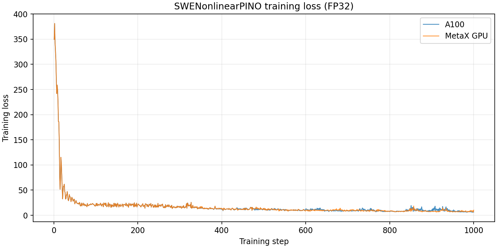
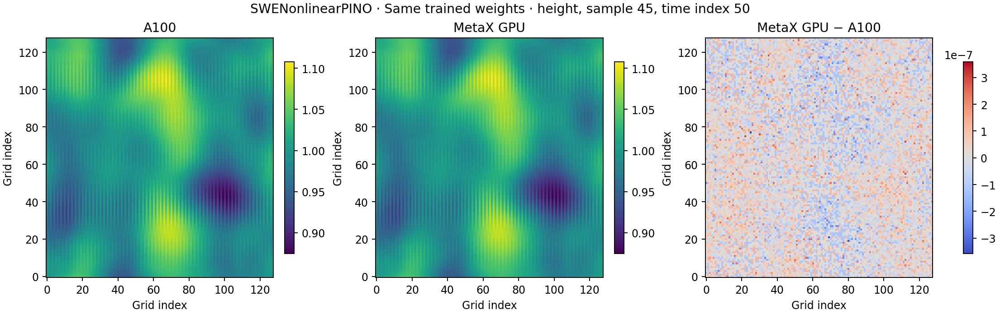

# 沐曦 GPU 运行 PhysicsNeMo SWE Nonlinear PINO 说明文档

## 一、SWE Nonlinear PINO 简介

SWE Nonlinear PINO 是 [PhysicsNeMo v2.0.0](https://github.com/NVIDIA/physicsnemo/tree/v2.0.0/examples/cfd/swe_nonlinear_pino) 的非线性浅水方程的物理约束神经算子案例，面向水位和水平速度的耦合演化，使用初始状态预测后续场变量并将方程残差加入损失。本文档固定使用 PhysicsNeMo 仓库提交 `1ca85d65ac2ce28ea9762910c09a954c08a37140`。

本目录采用文档与容器适配方式，不包含 PhysicsNeMo 源码、浅水方程训练与验证数据及模型权重。此案例无需下载外部数据：PhysicsNeMo v2.0.0 的 `examples/cfd/swe_nonlinear_pino/download_data.py` 会生成随机初始水面，并调用官方浅水方程求解器演化样本，最后将张量保存为 `datasets/swe_nl_dataset.pt`。脚本名和 `download_SWE_NL_dataset` 函数名沿用历史命名，实际操作是生成并保存数据。

## 二、沐曦 GPU 环境配置与运行

### 2.1 环境准备

使用沐曦开发者社区提供的[PhysicsNeMo MACA 镜像](https://developer.metax-tech.com/softnova/docker?chip_name=MXC500&package_name=physicsnemo-maca:2.0.0-3.9.0.12-torch2.8-py312-ubuntu24.04-amd64)启动容器：

```bash
docker run --rm -it \
  --device=/dev/mxcd \
  --device=/dev/dri \
  --group-add video \
  --shm-size=8G \
  --security-opt seccomp=unconfined \
  --ulimit memlock=-1 \
  --ulimit stack=67108864 \
  -v /host_dir:/workspace \
  cr.metax-tech.com/public-ai-release/physicsnemo-maca:2.0.0-3.9.0.12-torch2.8-py312-ubuntu24.04-amd64 \
  /bin/bash
```

**参数说明：**

- `--device=/dev/mxcd --device=/dev/dri`：将沐曦 GPU 设备节点传入容器。
- `--group-add video`：将容器进程加入 `video` 组，以便访问 GPU 设备。
- `--shm-size=8G`：设置共享内存大小，供 PyTorch 和图数据加载使用。
- `--security-opt seccomp=unconfined`：允许 MACA 运行时使用所需的系统调用。
- `--ulimit memlock=-1`：取消内存锁定限制，避免 GPU 运行时申请锁页内存失败。
- `--ulimit stack=67108864`：设置线程栈大小，满足模型和数据处理过程的运行需求。
- `-v /host_dir:/workspace`：挂载工作目录；`/host_dir` 是主机路径，`/workspace` 是容器内路径。

### 2.2 验证环境

进入容器后，先验证沐曦 PyTorch 与 GPU 是否可用：

```bash
python -c "import torch; assert torch.cuda.is_available(); print('PyTorch version:', torch.__version__); print('CUDA OK:', torch.cuda.get_device_name(0))"
```

命令应打印 PyTorch 版本和 `cuda:0` 对应的沐曦 GPU 名称。例如：

```text
PyTorch version: 2.8.0+metax3.9.0.8
CUDA OK: MetaX C500
```

本说明已验证的输出为 `PyTorch version: 2.8.0+metax3.9.0.8`、`CUDA OK: MetaX C500`；实际版本号和设备名称以 PhysicsNeMo MACA 镜像及硬件型号为准。

如果 `torch.cuda.is_available()` 为 `False`，请先检查宿主机驱动、`/dev/mxcd` 和 `/dev/dri` 设备节点挂载、`video` 用户组权限以及容器启动参数，再继续安装 SWE Nonlinear PINO。

### 2.3 配置 MACA 编译环境

PhysicsNeMo MACA 镜像已配置 MACA 编译环境，并预装沐曦 PyTorch、 PhysicsNeMo 和 Warp；本案例不需要重复安装这些组件。进入容器后可验证：

```bash
python -c "import torch, physicsnemo, warp; assert torch.cuda.is_available(); print('PyTorch:', torch.__version__); print('PhysicsNeMo:', physicsnemo.__version__); print('Warp:', warp.__version__)"
```

命令应输出：

```text
PyTorch: 2.8.0+metax3.9.0.8
PhysicsNeMo: 2.0.0
Warp: 1.12.1
```

### 2.4 安装 SWE Nonlinear PINO 依赖

推荐使用第四节 Dockerfile 构建的镜像。镜像已包含 PhysicsNeMo 、沐曦 PyTorch 和 Warp。

本案例额外依赖：`imageio`、`Cython>=0.29`、`chaospy>=4.3.7`、`matplotlib==3.11.2`、`mistune>=2.0,<2.1`、`numpoly<=1.3.4`、`numpy-stl>=2.16,<2.17`、`opencv-python>=4.8.1.78`、`pint>=0.19.2`、`pyvista==0.49.2`、`symengine>=0.10.0`、`torch-optimizer>=0.3.0`、`transforms3d>=0.3.1`、`vtk==9.7.2`、`nvidia-physicsnemo.sym==2.0.0`。PhysicsNeMo Sym 提供 PDE 组件，imageio/Matplotlib 用于结果输出，VTK/PyVista 用于数据处理。

对应的安装命令：

```bash
PYPI_INDEX_URL=https://pypi.tuna.tsinghua.edu.cn/simple
python -m pip install --no-cache-dir --no-deps --no-build-isolation \
    "nvidia-physicsnemo.sym==2.0.0" && \
    cp -a /opt/conda/lib/python3.12/site-packages/physicsnemo/sym \
    /root/physicsnemo/physicsnemo/sym
python -m pip install --no-cache-dir \
    "Cython>=0.29" \
    "chaospy>=4.3.7" \
    "mistune>=2.0,<2.1" \
    "numpoly<=1.3.4" \
    "numpy-stl>=2.16,<2.17" \
    "opencv-python>=4.8.1.78" \
    "pint>=0.19.2" \
    "symengine>=0.10.0" \
    "torch-optimizer>=0.3.0" \
    "transforms3d>=0.3.1"
python -m pip install --no-cache-dir \
    "matplotlib==3.11.2"
python -m pip install --no-cache-dir --index-url="$PYPI_INDEX_URL" \
    "vtk==9.7.2" "pyvista==0.49.2"
python -m pip install --no-cache-dir --index-url="$PYPI_INDEX_URL" "imageio"
```

验证依赖及案例入口（在交付镜像的默认工作目录执行）：

```bash
python -c 'import physicsnemo, torch, warp; assert physicsnemo.__version__ == "2.0.0"; print(physicsnemo.__version__, torch.__version__, warp.__version__)'
python -c 'import pathlib, runpy, sys; p=pathlib.Path("train_swe_nl_pino.py"); sys.path.insert(0, str(p.parent.resolve())); runpy.run_path(str(p))'
```

## 三、运行与验证

### 3.1 数据准备、训练与推理

案例无需下载外部数据。在 PhysicsNeMo 源码目录下运行官方数据生成脚本，通过浅水方程求解器生成数据，保存至 `datasets/swe_nl_dataset.pt`：

```bash
cd examples/cfd/swe_nonlinear_pino
python download_data.py
```

运行官方训练入口：

```bash
python train_swe_nl_pino.py
```

推理集成在训练脚本中，每 15 个 epoch 对测试集推理并绘图，训练结束后生成预测动画。本次对比使用 50 个生成样本，其中 45 个训练、5 个留出；采用 FP32、随机种子 1234 和 1,000 次更新。验证使用的训练实现对 `physicsnemo_fourier` 残差的 batch 维切片进行了修正，以适配 batch size 为 1 的设置。

### 3.2 训练与推理结果

下图展示 A100 与 MetaX GPU 在相同初始权重及样本顺序下的训练 Loss。两端 Loss 整体下降，数值处于同一量级。



下图使用相同的训练后模型权重与相同留出输入，展示样本 45 在时间索引 50 的高度场预测。以 A100 输出为基准，5 个留出样本、全部 101 个时间点和三个输出字段的整体相对 L2 误差为 `8.39e-8`，两端推理结果基本一致。



## 四、Dockerfile 构建

本目录提供可直接构建的 Dockerfile。Dockerfile 使用上述 PhysicsNeMo MACA 镜像，安装第二节列出的本案例依赖，并在构建时核对 PhysicsNeMo v2.0.0 和 `train_swe_nl_pino.py` 案例入口；构建过程不打包 浅水方程训练与验证数据及模型权重。

在 `SWENonlinearPINO` 目录执行：

```bash
docker build --build-arg PYPI_INDEX_URL=https://pypi.tuna.tsinghua.edu.cn/simple -t physicsnemo-swenonlinearpino:maca .
```

构建完成后，使用下列命令启动镜像，并按第三节执行模型适配验证：

```bash
docker run --rm -it \
  --device=/dev/mxcd \
  --device=/dev/dri \
  --group-add video \
  --shm-size=8G \
  --security-opt seccomp=unconfined \
  --ulimit memlock=-1 \
  --ulimit stack=67108864 \
  -v /host_dir:/workspace \
  physicsnemo-swenonlinearpino:maca \
  /bin/bash
```

请将 `/host_dir` 替换为主机侧实际工作目录。该挂载用于访问使用者的数据和输出。

## 五、其他

1. 开发者在初次使用曦云 GPU 运行 SWE Nonlinear PINO 时，遵循本手册搭建环境后，可以按照 [PhysicsNeMo SWE Nonlinear PINO 官网](https://github.com/NVIDIA/physicsnemo/tree/v2.0.0/examples/cfd/swe_nonlinear_pino)的教程开展训练及推理。
2. 沐曦仅维护部分 case 的正确性，如出现运行问题，可提交 issue，亦可以在[沐曦开发者社区](https://developer.metax-tech.com)提交 bug 反馈。
3. 了解更多沐曦开源项目，请参考[沐曦开源社区](https://github.com/metax-maca)。

---

本文档仅提供相关软件的配置与使用说明，不包含亦不分发前述软件的源代码或目标代码，且不涉及对其源代码的任何修改。您按照本文档配置、部署或使用相关软件时，应遵守适用许可证规定的条款与条件。相关软件的源代码、许可证全文、版权与归属声明及其他项目文档，请以其官方网站或原始发布页面为准。

Copyright (c) 2026 MetaX Integrated Circuits (Shanghai) Co., Ltd. All rights reserved.
