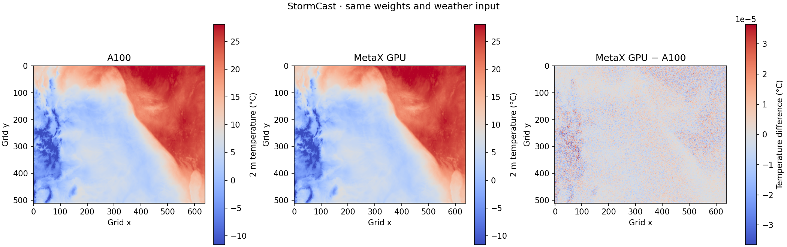
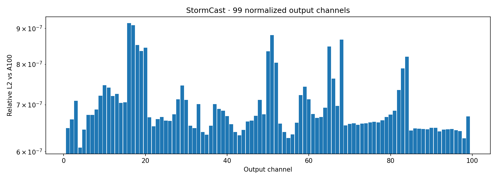

# 沐曦 GPU 运行 PhysicsNeMo StormCast 说明文档

## 一、 PhysicsNeMo StormCast 简介

StormCast 面向对流尺度天气预报，使用上一时刻 HRRR 状态与 ERA5 背景信息，通过 regression 与 diffusion 网络预测下一时刻高分辨率大气状态，并支持自回归滚动。本文档对应 PhysicsNeMo v2.0.0，PhysicsNeMo 源码 tag 经核对对应提交 SHA `1ca85d65ac2ce28ea9762910c09a954c08a37140`。

本目录仅提供 Dockerfile、LICENSE 和本说明，不包含 PhysicsNeMo 源码、训练数据或模型权重。默认数据管线需要时间对齐的 HRRR 与 ERA5 Zarr 数据；diffusion 训练还需要 regression checkpoint。数据布局和变量说明见[PhysicsNeMo StormCast 案例说明](https://github.com/NVIDIA/physicsnemo/tree/v2.0.0/examples/weather/stormcast)、[NOAA HRRR](https://rapidrefresh.noaa.gov/hrrr/) 与 [ECMWF ERA5](https://www.ecmwf.int/en/forecasts/dataset/ecmwf-reanalysis-v5)。

## 二、沐曦 GPU 环境配置与运行

### 2.1 环境准备

使用沐曦开发者社区提供的[PhysicsNeMo MACA 镜像](https://developer.metax-tech.com/softnova/docker?chip_name=MXC500&package_name=physicsnemo-maca:2.0.0-3.9.0.12-torch2.8-py312-ubuntu24.04-amd64)启动容器：

```bash
docker run --rm -it \
  --device=/dev/mxcd \
  --device=/dev/dri \
  --group-add video \
  --shm-size=8G \
  --security-opt seccomp=unconfined \
  --ulimit memlock=-1 \
  --ulimit stack=67108864 \
  -v /host_dir:/workspace \
  cr.metax-tech.com/public-ai-release/physicsnemo-maca:2.0.0-3.9.0.12-torch2.8-py312-ubuntu24.04-amd64 \
  /bin/bash
```

**参数说明：**

- `--device=/dev/mxcd --device=/dev/dri`：将沐曦 GPU 设备节点传入容器。
- `--group-add video`：将容器进程加入 `video` 组，以便访问 GPU 设备。
- `--shm-size=8G`：设置共享内存大小，供 PyTorch 和图数据加载使用。
- `--security-opt seccomp=unconfined`：允许 MACA 运行时使用所需的系统调用。
- `--ulimit memlock=-1`：取消内存锁定限制，避免 GPU 运行时申请锁页内存失败。
- `--ulimit stack=67108864`：设置线程栈大小，满足模型和数据处理过程的运行需求。
- `-v /host_dir:/workspace`：挂载工作目录；`/host_dir` 是主机路径，`/workspace` 是容器内路径。

### 2.2 验证环境

进入容器后，先验证沐曦 PyTorch 与 GPU 是否可用：

```bash
python -c "import torch; assert torch.cuda.is_available(); print('PyTorch version:', torch.__version__); print('CUDA OK:', torch.cuda.get_device_name(0))"
```

本次在 MetaX C500 上的输出为：

```text
PyTorch version: 2.8.0+metax3.9.0.8
CUDA OK: MetaX C500
```

如果 `torch.cuda.is_available()` 为 `False`，请检查宿主机驱动、`/dev/mxcd` 和 `/dev/dri` 设备节点挂载、`video` 用户组权限以及容器启动参数，再继续安装该案例。

### 2.3 配置 MACA 编译环境

PhysicsNeMo MACA 镜像已配置 MACA 编译环境，并预装沐曦 PyTorch、 PhysicsNeMo 和 Warp；本案例不需要重复安装这些组件。进入容器后可验证：

```bash
python -c "import torch, physicsnemo, warp; assert torch.cuda.is_available(); print('PyTorch:', torch.__version__); print('PhysicsNeMo:', physicsnemo.__version__); print('Warp:', warp.__version__)"
```

本次验证输出：

```text
PyTorch: 2.8.0+metax3.9.0.8
PhysicsNeMo: 2.0.0
Warp: 1.12.1
```


### 2.4 安装 StormCast 依赖

推荐使用第四节 Dockerfile 构建的镜像。镜像已包含 PhysicsNeMo 、沐曦 PyTorch 和 Warp。

PhysicsNeMo `requirements.txt` 包含 `pyproj` 与 `torch-optimi`（代码中以 `optimi` 导入）；Dockerfile 另安装 `tensorboard`、`matplotlib`、`dask==2025.3.0`、`xarray` 和 `zarr==2.18.7`。

对应的安装命令：

```bash
python -m pip install --index-url=https://pypi.tuna.tsinghua.edu.cn/simple -r /root/physicsnemo/examples/weather/stormcast/requirements.txt
python -m pip install --index-url=https://pypi.tuna.tsinghua.edu.cn/simple tensorboard
python -m pip install --index-url=https://pypi.tuna.tsinghua.edu.cn/simple matplotlib
python -m pip install --index-url=https://pypi.tuna.tsinghua.edu.cn/simple "dask==2025.3.0" xarray zarr==2.18.7
```

验证依赖：

```bash
cd /root/physicsnemo/examples/weather/stormcast
python train.py --help
```

## 三、运行与验证

### 3.1 数据准备与运行命令

官方案例使用时间对齐的 HRRR 和 ERA5 数据。分别从 [NOAA HRRR](https://rapidrefresh.noaa.gov/hrrr/) 和 [ECMWF ERA5](https://www.ecmwf.int/en/forecasts/dataset/ecmwf-reanalysis-v5) 获取所需变量，并按照 [StormCast 案例的数据格式说明](https://github.com/NVIDIA/physicsnemo/tree/v2.0.0/examples/weather/stormcast#datasets)准备 Zarr 数据及归一化统计；在 `config/dataset/hrrr_era5.yaml` 中设置实际路径。官方案例未提供一键下载脚本。

在案例目录先训练 regression 模型：

```bash
cd /root/physicsnemo/examples/weather/stormcast
python train.py --config-name regression training.experiment_name=regression
```

在 diffusion 配置中将 `model.regression_weights` 指向训练得到的 regression 权重，再运行：

```bash
python train.py --config-name diffusion training.experiment_name=diffusion
```

在 `config/inference/stormcast.yaml` 中配置 regression、diffusion 权重及推理参数，然后运行：

```bash
python inference.py --config-name stormcast_inference
```

### 3.2 推理结果

使用相同模型权重和输入，以 FP32 比较 A100 与 MetaX GPU 的 StormCast regression 网络输出。输入包含真实 HRRR 状态、GFS 条件场和静态变量，网格大小为 512×640；GFS 在本次比较中作为条件场，官方默认工作流使用 ERA5。

下图展示两端预测的 2 米气温场及差值；主图使用相同色标，差值图色限取绝对差的第 99.9 百分位。以 A100 为基准，全部 99 个归一化输出通道的整体相对 L2 为 6.78e-7，两端相同权重下的推理结果基本一致。



下图展示 99 个输出通道各自相对 A100 的 L2 差异，范围为 6.08e-7 至 9.16e-7。



## 四、Dockerfile 构建

本目录提供可直接构建的 Dockerfile。Dockerfile 以 `cr.metax-tech.com/public-ai-release/physicsnemo-maca:2.0.0-3.9.0.12-torch2.8-py312-ubuntu24.04-amd64` 为基础，移除基础镜像中不兼容的 `flash-attn-3`，安装本节列出的额外依赖，并在构建时导入 StormCastUNet 与数据依赖，并运行 `train.py --help`。构建上下文为本模型目录；镜像不打包 PhysicsNeMo 源码、训练数据和模型权重。

在 `StormCast` 目录执行：

```bash
unset no_proxy https_proxy NO_PROXY HTTPS_PROXY HTTP_PROXY http_proxy
docker build --network=host --build-arg PYPI_INDEX_URL=https://pypi.tuna.tsinghua.edu.cn/simple -t physicsnemo-stormcast:c500 .
```

构建完成后，使用下列命令启动镜像，并按第三节执行 StormCast 验证：

```bash
docker run --rm -it \
  --device=/dev/mxcd \
  --device=/dev/dri \
  --group-add video \
  --shm-size=8G \
  --security-opt seccomp=unconfined \
  --ulimit memlock=-1 \
  --ulimit stack=67108864 \
  -v /host_dir:/workspace \
  physicsnemo-stormcast:c500 \
  /bin/bash
```

请将 `/host_dir` 替换为主机侧实际工作目录；此挂载用于放置数据和保存输出。

## 五、其他

1. 开发者在初次使用曦云 GPU 运行 StormCast 时，遵循本手册搭建环境后，可以按照 [PhysicsNeMo StormCast 官网](https://github.com/NVIDIA/physicsnemo/tree/v2.0.0/examples/weather/stormcast)的教程开展训练及推理。
2. 沐曦仅维护部分 case 的正确性，如出现运行问题，可提交 issue，亦可以在[沐曦开发者社区](https://developer.metax-tech.com)提交 bug 反馈。
3. 了解更多沐曦开源项目，请参考[沐曦开源社区](https://github.com/metax-maca)。

---

本文档仅提供相关软件的配置与使用说明，不包含亦不分发前述软件的源代码或目标代码，且不涉及对其源代码的任何修改。您按照本文档配置、部署或使用相关软件时，应遵守适用许可证规定的条款与条件。相关软件的源代码、许可证全文、版权与归属声明及其他项目文档，请以其官方网站或原始发布页面为准。

Copyright (c) 2026 MetaX Integrated Circuits (Shanghai) Co., Ltd. All rights reserved.
