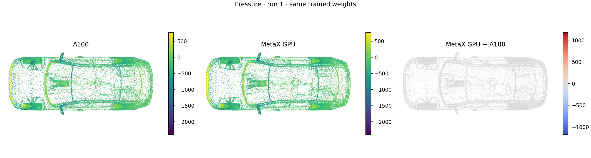
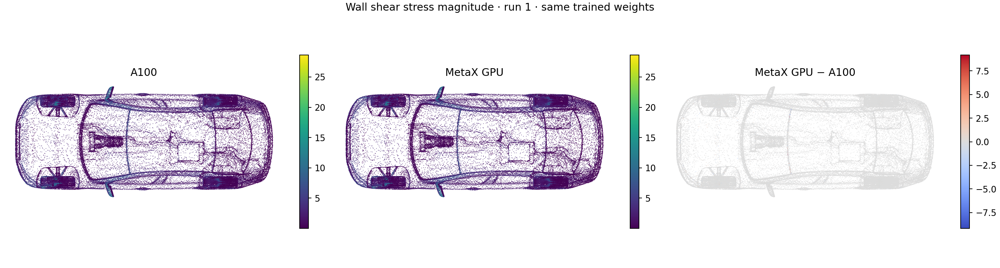

# 沐曦 GPU 运行 PhysicsNeMo Transformer Models 说明文档

## 一、Transformer Models 简介

Transformer Models 是 [PhysicsNeMo v2.0.0](https://github.com/NVIDIA/physicsnemo/tree/v2.0.0/examples/cfd/external_aerodynamics/transformer_models) 的汽车外流场 Transformer 代理模型集合，面向 DrivAerML 的表面或体积点云，使用 Transolver/GeoTransolver 的注意力机制预测 CFD 场变量。本文档固定使用 PhysicsNeMo 仓库提交 `1ca85d65ac2ce28ea9762910c09a954c08a37140`。

本目录采用文档与容器适配方式，不包含 PhysicsNeMo 源码、DrivAerML 数据、预处理后的 Zarr 文件和模型权重。PhysicsNeMo 使用 [DrivAerML 数据集](https://caemldatasets.org/drivaerml/)，并由 PhysicsNeMo-Curator 生成训练所需的 Zarr 数据；准备步骤见[PhysicsNeMo 案例](https://github.com/NVIDIA/physicsnemo/tree/v2.0.0/examples/cfd/external_aerodynamics/transformer_models)。

## 二、沐曦 GPU 环境配置与运行

### 2.1 环境准备

使用沐曦开发者社区提供的[PhysicsNeMo MACA 镜像](https://developer.metax-tech.com/softnova/docker?chip_name=MXC500&package_name=physicsnemo-maca:2.0.0-3.9.0.12-torch2.8-py312-ubuntu24.04-amd64)启动容器：

```bash
docker run --rm -it \
  --device=/dev/mxcd \
  --device=/dev/dri \
  --group-add video \
  --shm-size=8G \
  --security-opt seccomp=unconfined \
  --ulimit memlock=-1 \
  --ulimit stack=67108864 \
  -v /host_dir:/workspace \
  cr.metax-tech.com/public-ai-release/physicsnemo-maca:2.0.0-3.9.0.12-torch2.8-py312-ubuntu24.04-amd64 \
  /bin/bash
```

**参数说明：**

- `--device=/dev/mxcd --device=/dev/dri`：将沐曦 GPU 设备节点传入容器。
- `--group-add video`：将容器进程加入 `video` 组，以便访问 GPU 设备。
- `--shm-size=8G`：设置共享内存大小，供 PyTorch 和图数据加载使用。
- `--security-opt seccomp=unconfined`：允许 MACA 运行时使用所需的系统调用。
- `--ulimit memlock=-1`：取消内存锁定限制，避免 GPU 运行时申请锁页内存失败。
- `--ulimit stack=67108864`：设置线程栈大小，满足模型和数据处理过程的运行需求。
- `-v /host_dir:/workspace`：挂载工作目录；`/host_dir` 是主机路径，`/workspace` 是容器内路径。

### 2.2 验证环境

进入容器后，先验证沐曦 PyTorch 与 GPU 是否可用：

```bash
python -c "import torch; assert torch.cuda.is_available(); print('PyTorch version:', torch.__version__); print('CUDA OK:', torch.cuda.get_device_name(0))"
```

命令应打印 PyTorch 版本和 `cuda:0` 对应的沐曦 GPU 名称。例如：

```text
PyTorch version: 2.8.0+metax3.9.0.8
CUDA OK: MetaX C500
```

本说明已验证的输出为 `PyTorch version: 2.8.0+metax3.9.0.8`、`CUDA OK: MetaX C500`；实际版本号和设备名称以 PhysicsNeMo MACA 镜像及硬件型号为准。

如果 `torch.cuda.is_available()` 为 `False`，请先检查宿主机驱动、`/dev/mxcd` 和 `/dev/dri` 设备节点挂载、`video` 用户组权限以及容器启动参数，再继续安装 Transformer Models。

### 2.3 配置 MACA 编译环境

PhysicsNeMo MACA 镜像已配置 MACA 编译环境，并预装沐曦 PyTorch、 PhysicsNeMo 和 Warp；本案例不需要重复安装这些组件。进入容器后可验证：

```bash
python -c "import torch, physicsnemo, warp; assert torch.cuda.is_available(); print('PyTorch:', torch.__version__); print('PhysicsNeMo:', physicsnemo.__version__); print('Warp:', warp.__version__)"
```

命令应输出：

```text
PyTorch: 2.8.0+metax3.9.0.8
PhysicsNeMo: 2.0.0
Warp: 1.12.1
```

### 2.4 安装 Transformer Models 依赖

推荐使用第四节 Dockerfile 构建的镜像。镜像已包含 PhysicsNeMo 、沐曦 PyTorch 和 Warp。

本案例额外依赖：`tensorboard==2.21.0`、`tensorstore==0.1.86`、`torchinfo==1.8.0`、`zarr==3.4.2`。TensorStore/Zarr 读取数据，TensorBoard 记录训练信息，torchinfo 输出模型结构。

对应的安装命令：

```bash
python -m pip install --no-cache-dir \
    "tensorboard==2.21.0" \
    "tensorstore==0.1.86" \
    "zarr==3.4.2" \
    "torchinfo==1.8.0"
```

验证依赖及案例入口（在交付镜像的默认工作目录执行）：

```bash
python -c 'import physicsnemo, torch, warp; assert physicsnemo.__version__ == "2.0.0"; print(physicsnemo.__version__, torch.__version__, warp.__version__)'
python -c 'import pathlib, runpy, sys; p=pathlib.Path("src/train.py"); sys.path.insert(0, str(p.parent.resolve())); runpy.run_path(str(p))'
```

## 三、运行与验证

### 3.1 数据准备、训练与推理

Transolver 表面模型使用 [DrivAerML 数据集](https://caemldatasets.org/drivaerml/)。例如，可通过 AWS CLI 获取 `run_1` 的原始文件：

```bash
mkdir -p datasets/DrivAerML/run_1
aws s3 cp --no-sign-request --recursive \
  s3://caemldatasets/drivaer/dataset/run_1/ datasets/DrivAerML/run_1/
```

训练前参照 [PhysicsNeMo-Curator 的 DrivAerML 数据准备说明](https://github.com/NVIDIA/physicsnemo-curator/blob/main/examples/external_aerodynamics/README.md)将原始数据预处理为 Zarr，并在案例配置中设置数据及归一化文件路径。进入 PhysicsNeMo 案例目录后使用官方入口训练：

```bash
cd examples/cfd/external_aerodynamics/transformer_models
python src/train.py --config-name transolver_surface
```

对 Zarr 数据执行官方验证集推理时，在配置中设置数据路径及 `data.return_mesh_features=true`，并指定模型目录：

```bash
python src/inference_on_zarr.py --config-name transolver_surface \
  run_id=/path/to/model data.return_mesh_features=true
```

对 VTK 表面数据推理可使用官方 `src/inference_on_vtk.py`。输入目录按 `run_1/boundary_1.vtp` 和 `run_1/drivaer_1_single_solid.stl` 等组织，STL 几何按案例要求准备为单实体文件；模型目录应包含权重和训练状态文件。以下示例采用本次验证的 20 层模型和 10,000 点推理分块设置：

```bash
python src/inference_on_vtk.py --config-name transolver_surface \
  model.n_layers=20 compile=false data.resolution=10000 \
  checkpoint_dir=/path/to/checkpoint data.normalization_dir=src \
  +vtk_inference.input_dir=/path/to/DrivAerML \
  +vtk_inference.output_dir=/path/to/output \
  '+vtk_inference.run_indices=[1]'
```

### 3.2 相同权重推理结果

使用相同的 Transolver DrivAerML 表面模型训练后权重和 `run_1` 输入，在 A100 与 MetaX GPU 上分别进行 FP32 推理。下图展示车身表面压力预测及两端差值。以 A100 预测为基准，对该样本全部约 883 万个表面单元统计，压力场的相对 L2 差异为 **3.67%**，两端预测的主要分布接近。



下图展示同一样本的壁面剪切力大小及两端差值；以 A100 预测为基准，对全部表面单元的三个剪切力分量合并统计，相对 L2 差异为 **5.20%**。两端预测场的主要分布接近。两图为表面单元的抽样投影，L2 指标基于完整输出计算。



## 四、Dockerfile 构建

本目录提供可直接构建的 Dockerfile。Dockerfile 使用上述 PhysicsNeMo MACA 镜像，安装第二节列出的本案例依赖，并在构建时核对 PhysicsNeMo v2.0.0 和 `src/train.py` 案例入口；构建过程不打包 DrivAerML 数据、预处理后的 Zarr 文件和模型权重。

在 `TransformerModels` 目录执行：

```bash
docker build -t physicsnemo-transformermodels:2.0.0-maca .
```

构建完成后，使用下列命令启动镜像，并按第三节执行模型适配验证：

```bash
docker run --rm -it \
  --device=/dev/mxcd \
  --device=/dev/dri \
  --group-add video \
  --shm-size=8G \
  --security-opt seccomp=unconfined \
  --ulimit memlock=-1 \
  --ulimit stack=67108864 \
  -v /host_dir:/workspace \
  physicsnemo-transformermodels:2.0.0-maca \
  /bin/bash
```

请将 `/host_dir` 替换为主机侧实际工作目录。该挂载用于访问使用者的数据和输出。

## 五、其他

1. 开发者在初次使用曦云 GPU 运行 Transformer Models 时，遵循本手册搭建环境后，可以按照 [PhysicsNeMo Transformer Models 官网](https://github.com/NVIDIA/physicsnemo/tree/v2.0.0/examples/cfd/external_aerodynamics/transformer_models)的教程开展训练及推理。
2. 沐曦仅维护部分 case 的正确性，如出现运行问题，可提交 issue，亦可以在[沐曦开发者社区](https://developer.metax-tech.com)提交 bug 反馈。
3. 了解更多沐曦开源项目，请参考[沐曦开源社区](https://github.com/metax-maca)。

---

本文档仅提供相关软件的配置与使用说明，不包含亦不分发前述软件的源代码或目标代码，且不涉及对其源代码的任何修改。您按照本文档配置、部署或使用相关软件时，应遵守适用许可证规定的条款与条件。相关软件的源代码、许可证全文、版权与归属声明及其他项目文档，请以其官方网站或原始发布页面为准。

Copyright (c) 2026 MetaX Integrated Circuits (Shanghai) Co., Ltd. All rights reserved.
