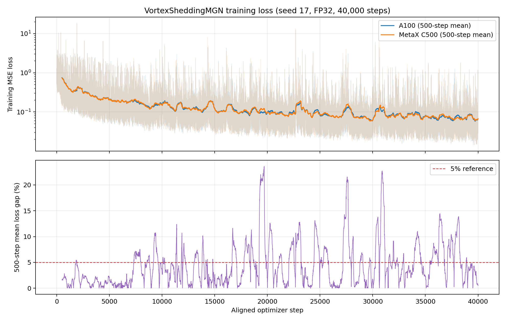
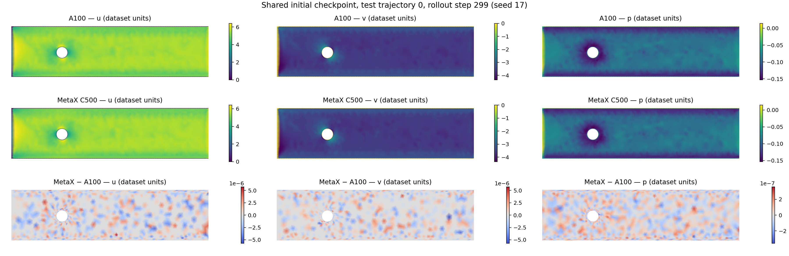
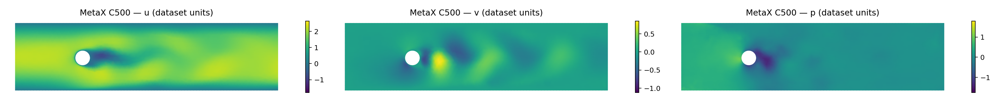

# 沐曦 GPU 运行 PhysicsNeMo Vortex Shedding MGN 说明文档

## 一、Vortex Shedding MGN 简介

Vortex Shedding MGN 是 [PhysicsNeMo v2.0.0](https://github.com/NVIDIA/physicsnemo/tree/v2.0.0/examples/cfd/vortex_shedding_mgn) 的参数化几何瞬态涡脱落的 MeshGraphNet 案例，面向二维网格随时间变化的流动，使用当前节点速度、压力及网格连接关系预测下一时间步速度和压力。本文档固定使用 PhysicsNeMo 仓库提交 `1ca85d65ac2ce28ea9762910c09a954c08a37140`。

本目录采用文档与容器适配方式，不包含 PhysicsNeMo 源码、DeepMind cylinder_flow 涡脱落数据和模型权重。PhysicsNeMo 案例使用 [DeepMind MeshGraphNets 数据](https://github.com/deepmind/deepmind-research/tree/master/meshgraphnets)，其 `raw_dataset/download_dataset.sh` 提供获取入口。

## 二、沐曦 GPU 环境配置与运行

### 2.1 环境准备

使用沐曦开发者社区提供的[PhysicsNeMo MACA 镜像](https://developer.metax-tech.com/softnova/docker?chip_name=MXC500&package_name=physicsnemo-maca:2.0.0-3.9.0.12-torch2.8-py312-ubuntu24.04-amd64)启动容器：

```bash
docker run --rm -it \
  --device=/dev/mxcd \
  --device=/dev/dri \
  --group-add video \
  --shm-size=8G \
  --security-opt seccomp=unconfined \
  --ulimit memlock=-1 \
  --ulimit stack=67108864 \
  -v /host_dir:/workspace \
  cr.metax-tech.com/public-ai-release/physicsnemo-maca:2.0.0-3.9.0.12-torch2.8-py312-ubuntu24.04-amd64 \
  /bin/bash
```

**参数说明：**

- `--device=/dev/mxcd --device=/dev/dri`：将沐曦 GPU 设备节点传入容器。
- `--group-add video`：将容器进程加入 `video` 组，以便访问 GPU 设备。
- `--shm-size=8G`：设置共享内存大小，供 PyTorch 和图数据加载使用。
- `--security-opt seccomp=unconfined`：允许 MACA 运行时使用所需的系统调用。
- `--ulimit memlock=-1`：取消内存锁定限制，避免 GPU 运行时申请锁页内存失败。
- `--ulimit stack=67108864`：设置线程栈大小，满足模型和数据处理过程的运行需求。
- `-v /host_dir:/workspace`：挂载工作目录；`/host_dir` 是主机路径，`/workspace` 是容器内路径。

### 2.2 验证环境

进入容器后，先验证沐曦 PyTorch 与 GPU 是否可用：

```bash
python -c "import torch; assert torch.cuda.is_available(); print('PyTorch version:', torch.__version__); print('CUDA OK:', torch.cuda.get_device_name(0))"
```

命令应打印 PyTorch 版本和 `cuda:0` 对应的沐曦 GPU 名称。例如：

```text
PyTorch version: 2.8.0+metax3.9.0.8
CUDA OK: MetaX GPU
```

实际版本号和设备名称以使用的 PhysicsNeMo MACA 镜像及设备为准。

如果 `torch.cuda.is_available()` 为 `False`，请先检查宿主机驱动、`/dev/mxcd` 和 `/dev/dri` 设备节点挂载、`video` 用户组权限以及容器启动参数，再继续安装 Vortex Shedding MGN。

### 2.3 配置 MACA 编译环境

PhysicsNeMo MACA 镜像已配置 MACA 编译环境，并预装沐曦 PyTorch、 PhysicsNeMo 和 Warp；本案例不需要重复安装这些组件。进入容器后可验证：

```bash
python -c "import torch, physicsnemo, warp; assert torch.cuda.is_available(); print('PyTorch:', torch.__version__); print('PhysicsNeMo:', physicsnemo.__version__); print('Warp:', warp.__version__)"
```

命令应输出：

```text
PyTorch: 2.8.0+metax3.9.0.8
PhysicsNeMo: 2.0.0
Warp: 1.12.1
```

### 2.4 安装 Vortex Shedding MGN 依赖

推荐使用第四节 Dockerfile 构建的镜像。镜像已包含 PhysicsNeMo 、沐曦 PyTorch 和 Warp。

本案例额外依赖：`pyvista==0.49.2`、`tfrecord==1.14.7`、`vtk==9.7.2`。TFRecord 读取数据，PyVista/VTK 处理网格。

对应的安装命令：

```bash
PYPI_INDEX_URL=https://pypi.tuna.tsinghua.edu.cn/simple
python -m pip install --no-cache-dir \
    "tfrecord==1.14.7"
python -m pip install --no-cache-dir --index-url="$PYPI_INDEX_URL" \
    "vtk==9.7.2" "pyvista==0.49.2"
```

验证依赖及案例入口（在交付镜像的默认工作目录执行）：

```bash
python -c 'import physicsnemo, torch, warp; assert physicsnemo.__version__ == "2.0.0"; print(physicsnemo.__version__, torch.__version__, warp.__version__)'
python -c 'import pathlib, runpy, sys; p=pathlib.Path("train.py"); sys.path.insert(0, str(p.parent.resolve())); runpy.run_path(str(p))'
```

## 三、运行与验证

### 3.1 训练与推理命令

#### 数据准备

在官方案例目录运行下载脚本，获取 DeepMind 的 `cylinder_flow` 数据集：

```bash
cd /root/physicsnemo/examples/cfd/vortex_shedding_mgn/raw_dataset
sh download_dataset.sh cylinder_flow
```

脚本将数据保存到 `raw_dataset/cylinder_flow`。在案例的 `conf/config.yaml` 中将 `data_dir` 指向实际数据目录。


准备好 cylinder_flow 数据集，并在案例的 `conf/config.yaml` 中配置 `data_dir`。进入官方案例目录，执行训练：

```bash
cd /root/physicsnemo/examples/cfd/vortex_shedding_mgn
python train.py
```

训练完成后，使用训练生成的检查点执行滚动推理：

```bash
python inference.py
```

训练和推理使用 `conf/config.yaml` 中的 `ckpt_path`；推理会将测试数据的预测动画保存到输出目录的 `animations` 子目录。

### 3.2 训练与滚动推理

使用 cylinder_flow 数据集进行训练和推理。训练采用 FP32、随机种子 17，运行 40,000 个优化步，使用 400 条训练序列中的 100 条。

下图对比 NVIDIA A100 与 MetaX GPU 的训练 MSE Loss：浅色线为逐步 Loss，实线为 500 步滑动均值，下方为两端滑动均值相对 A100 的差异。两端 Loss 整体下降，滑动均值的平均相对差异为 4.36%，变化趋势基本一致。



下图使用相同的初始模型权重和测试轨迹，比较 NVIDIA A100 与 MetaX GPU 在第 299 个滚动预测帧的速度分量 `u`、`v` 和压力 `p`；下排为 MetaX 减 A100 的差值。对该轨迹全部 299 帧、所有节点和三个字段，以 A100 输出的 L2 范数为基准计算，整体相对 L2 为 2.60e-7。两端在相同权重下的推理结果基本一致。



下图展示 MetaX GPU 训练 40,000 步后的检查点对同一测试轨迹的第 299 个滚动预测帧，包括速度分量 `u`、`v` 和压力 `p`。



## 四、Dockerfile 构建

本目录提供可直接构建的 Dockerfile。Dockerfile 使用上述 PhysicsNeMo MACA 镜像，安装第二节列出的本案例依赖，并在构建时核对 PhysicsNeMo v2.0.0 和 `train.py` 案例入口；构建过程不打包 DeepMind cylinder_flow 涡脱落数据和模型权重。

在 `VortexSheddingMGN` 目录执行：

```bash
docker build --build-arg PYPI_INDEX_URL=https://pypi.tuna.tsinghua.edu.cn/simple -t physicsnemo-vortexsheddingmgn:2.0.0-maca .
```

构建完成后，使用下列命令启动镜像：

```bash
docker run --rm -it \
  --device=/dev/mxcd \
  --device=/dev/dri \
  --group-add video \
  --shm-size=8G \
  --security-opt seccomp=unconfined \
  --ulimit memlock=-1 \
  --ulimit stack=67108864 \
  -v /host_dir:/workspace \
  physicsnemo-vortexsheddingmgn:2.0.0-maca \
  /bin/bash
```

请将 `/host_dir` 替换为主机侧实际工作目录。该挂载用于访问使用者的数据和输出。

## 五、其他

1. 开发者在初次使用曦云 GPU 运行 Vortex Shedding MGN 时，遵循本手册搭建环境后，可以按照 [PhysicsNeMo Vortex Shedding MGN 官网](https://github.com/NVIDIA/physicsnemo/tree/v2.0.0/examples/cfd/vortex_shedding_mgn)的教程开展训练及推理。
2. 沐曦仅维护部分 case 的正确性，如出现运行问题，可提交 issue，亦可以在[沐曦开发者社区](https://developer.metax-tech.com)提交 bug 反馈。
3. 了解更多沐曦开源项目，请参考[沐曦开源社区](https://github.com/metax-maca)。

---

本文档仅提供相关软件的配置与使用说明，不包含亦不分发前述软件的源代码或目标代码，且不涉及对其源代码的任何修改。您按照本文档配置、部署或使用相关软件时，应遵守适用许可证规定的条款与条件。相关软件的源代码、许可证全文、版权与归属声明及其他项目文档，请以其官方网站或原始发布页面为准。

Copyright (c) 2026 MetaX Integrated Circuits (Shanghai) Co., Ltd. All rights reserved.
