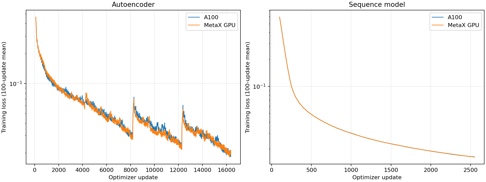
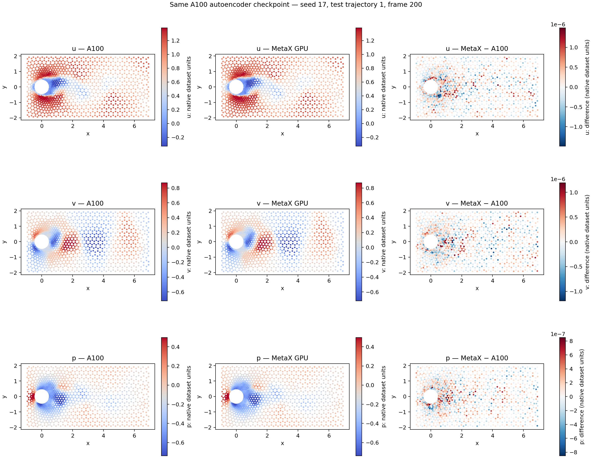
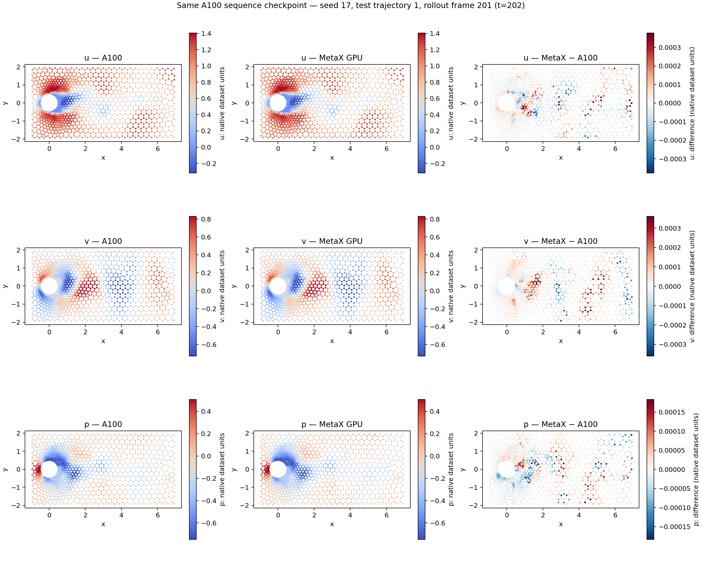

# 沐曦 GPU 运行 PhysicsNeMo Vortex Shedding Mesh Reduced 说明文档

## 一、Vortex Shedding Mesh Reduced 简介

Vortex Shedding Mesh Reduced 是 [PhysicsNeMo v2.0.0](https://github.com/NVIDIA/physicsnemo/tree/v2.0.0/examples/cfd/vortex_shedding_mesh_reduced) 的参数化几何瞬态涡脱落的网格降维案例，面向二维非规则三角网格，使用当前速度、压力和物理参数编码潜变量并预测后续时间步流场。本文档固定使用 PhysicsNeMo 仓库提交 `1ca85d65ac2ce28ea9762910c09a954c08a37140`。

本目录采用文档与容器适配方式，不包含 PhysicsNeMo 源码、OpenFOAM 涡脱落数据和模型权重。PhysicsNeMo 案例使用 51 个训练与 50 个测试算例，数据获取命令位于[PhysicsNeMo 案例说明](https://github.com/NVIDIA/physicsnemo/tree/v2.0.0/examples/cfd/vortex_shedding_mesh_reduced)。

## 二、沐曦 GPU 环境配置与运行

### 2.1 环境准备

使用沐曦开发者社区提供的[PhysicsNeMo MACA 镜像](https://developer.metax-tech.com/softnova/docker?chip_name=MXC500&package_name=physicsnemo-maca:2.0.0-3.9.0.12-torch2.8-py312-ubuntu24.04-amd64)启动容器：

```bash
docker run --rm -it \
  --device=/dev/mxcd \
  --device=/dev/dri \
  --group-add video \
  --shm-size=8G \
  --security-opt seccomp=unconfined \
  --ulimit memlock=-1 \
  --ulimit stack=67108864 \
  -v /host_dir:/workspace \
  cr.metax-tech.com/public-ai-release/physicsnemo-maca:2.0.0-3.9.0.12-torch2.8-py312-ubuntu24.04-amd64 \
  /bin/bash
```

**参数说明：**

- `--device=/dev/mxcd --device=/dev/dri`：将沐曦 GPU 设备节点传入容器。
- `--group-add video`：将容器进程加入 `video` 组，以便访问 GPU 设备。
- `--shm-size=8G`：设置共享内存大小，供 PyTorch 和图数据加载使用。
- `--security-opt seccomp=unconfined`：允许 MACA 运行时使用所需的系统调用。
- `--ulimit memlock=-1`：取消内存锁定限制，避免 GPU 运行时申请锁页内存失败。
- `--ulimit stack=67108864`：设置线程栈大小，满足模型和数据处理过程的运行需求。
- `-v /host_dir:/workspace`：挂载工作目录；`/host_dir` 是主机路径，`/workspace` 是容器内路径。

### 2.2 验证环境

进入容器后，先验证沐曦 PyTorch 与 GPU 是否可用：

```bash
python -c "import torch; assert torch.cuda.is_available(); print('PyTorch version:', torch.__version__); print('CUDA OK:', torch.cuda.get_device_name(0))"
```

命令应打印 PyTorch 版本和 `cuda:0` 对应的沐曦 GPU 名称。例如：

```text
PyTorch version: 2.8.0+metax3.9.0.8
CUDA OK: MetaX GPU
```

实际版本号和设备名称以使用的 PhysicsNeMo MACA 镜像及设备为准。

如果 `torch.cuda.is_available()` 为 `False`，请先检查宿主机驱动、`/dev/mxcd` 和 `/dev/dri` 设备节点挂载、`video` 用户组权限以及容器启动参数，再继续安装 Vortex Shedding Mesh Reduced。

### 2.3 配置 MACA 编译环境

PhysicsNeMo MACA 镜像已配置 MACA 编译环境，并预装沐曦 PyTorch、 PhysicsNeMo 和 Warp；本案例不需要重复安装这些组件。进入容器后可验证：

```bash
python -c "import torch, physicsnemo, warp; assert torch.cuda.is_available(); print('PyTorch:', torch.__version__); print('PhysicsNeMo:', physicsnemo.__version__); print('Warp:', warp.__version__)"
```

命令应输出：

```text
PyTorch: 2.8.0+metax3.9.0.8
PhysicsNeMo: 2.0.0
Warp: 1.12.1
```

### 2.4 验证 Vortex Shedding Mesh Reduced 依赖

推荐使用第四节 Dockerfile 构建的镜像。镜像已包含 PhysicsNeMo 、沐曦 PyTorch 和 Warp。

本案例无需安装额外 Python 依赖。

验证依赖及案例入口（在交付镜像的默认工作目录执行）：

```bash
python -c 'import physicsnemo, torch, warp; assert physicsnemo.__version__ == "2.0.0"; print(physicsnemo.__version__, torch.__version__, warp.__version__)'
python -c 'import pathlib, runpy, sys; p=pathlib.Path("train.py"); sys.path.insert(0, str(p.parent.resolve())); runpy.run_path(str(p))'
```

## 三、运行与验证

### 3.1 训练与推理命令

#### 数据准备

在官方案例目录从 NVIDIA NGC 获取并解压 cylinder-flow 数据：

```bash
cd /root/physicsnemo/examples/cfd/vortex_shedding_mesh_reduced
wget --content-disposition 'https://api.ngc.nvidia.com/v2/resources/nvidia/modulus/modulus_datasets_cylinder-flow/versions/v1/zip' -O modulus_datasets_cylinder-flow_v1.zip
unzip modulus_datasets_cylinder-flow_v1.zip
unzip dataset.zip
```

解压后按 `constants.py` 中的 `data_dir`、`pivotal_dir`、`mesh_dir` 和检查点配置核对路径。在案例目录执行自编码器训练及重建测试：

```bash
cd /root/physicsnemo/examples/cfd/vortex_shedding_mesh_reduced
python train.py
python test.py
```

使用与自编码器权重配套的潜变量训练时序模型。首次生成潜变量时，在 `constants.py` 中将 `produce_latents` 设置为 `True`；使用已有且配套的潜变量时设置为 `False`。然后运行：

```bash
python train_sequence.py
python test_sequence.py
```

潜变量生成选项和训练参数在 `constants.py` 中配置。

### 3.2 训练与推理结果

使用 cylinder-flow 数据的 51 条训练轨迹，A100 与 MetaX GPU 从相同初始权重出发，以 FP32 分别训练自编码器 4 个 epoch、时序模型 50 个 epoch。推理使用 10 条留出轨迹，每条轨迹包含 401 帧；时序模型以前 2 帧为输入，预测后续 399 步。本次训练参数采用跨设备验证配置。

下图比较两端自编码器及时序模型的训练 Loss，曲线为每 100 次更新的滑动均值。两个模型的 Loss 整体下降，A100 与 MetaX GPU 的结果处于同一量级。



下图展示相同的自编码器权重在两端对留出轨迹第 200 帧的速度分量 `u`、`v` 和压力 `p` 的重建结果及差值。以 A100 为基线，10 条留出轨迹全部 401 帧的整体相对 L2 为 8.45e-7，两端重建场整体接近。



下图展示相同时序模型权重下第 201 个预测帧的流场和跨设备差值。以 A100 为基线，10 条留出轨迹的完整 399 步预测整体相对 L2 为 1.65e-4。



本次相同权重下的重建和完整滚动预测未满足验证设定的组合阈值。

## 四、Dockerfile 构建

本目录提供可直接构建的 Dockerfile。Dockerfile 使用上述 PhysicsNeMo MACA 镜像，使用镜像预装组件，并在构建时核对 PhysicsNeMo v2.0.0 和 `train.py` 案例入口；构建过程不打包 OpenFOAM 涡脱落数据和模型权重。

在 `VortexSheddingMeshReduced` 目录执行：

```bash
docker build -t physicsnemo-vortex-shedding-mesh-reduced:2.0.0-maca .
```

构建完成后，使用下列命令启动镜像：

```bash
docker run --rm -it \
  --device=/dev/mxcd \
  --device=/dev/dri \
  --group-add video \
  --shm-size=8G \
  --security-opt seccomp=unconfined \
  --ulimit memlock=-1 \
  --ulimit stack=67108864 \
  -v /host_dir:/workspace \
  physicsnemo-vortex-shedding-mesh-reduced:2.0.0-maca \
  /bin/bash
```

请将 `/host_dir` 替换为主机侧实际工作目录。该挂载用于访问使用者的数据和输出。

## 五、其他

1. 开发者在初次使用曦云 GPU 运行 Vortex Shedding Mesh Reduced 时，遵循本手册搭建环境后，可以按照 [PhysicsNeMo Vortex Shedding Mesh Reduced 官网](https://github.com/NVIDIA/physicsnemo/tree/v2.0.0/examples/cfd/vortex_shedding_mesh_reduced)的教程开展训练及推理。
2. 沐曦仅维护部分 case 的正确性，如出现运行问题，可提交 issue，亦可以在[沐曦开发者社区](https://developer.metax-tech.com)提交 bug 反馈。
3. 了解更多沐曦开源项目，请参考[沐曦开源社区](https://github.com/metax-maca)。

---

本文档仅提供相关软件的配置与使用说明，不包含亦不分发前述软件的源代码或目标代码，且不涉及对其源代码的任何修改。您按照本文档配置、部署或使用相关软件时，应遵守适用许可证规定的条款与条件。相关软件的源代码、许可证全文、版权与归属声明及其他项目文档，请以其官方网站或原始发布页面为准。

Copyright (c) 2026 MetaX Integrated Circuits (Shanghai) Co., Ltd. All rights reserved.
