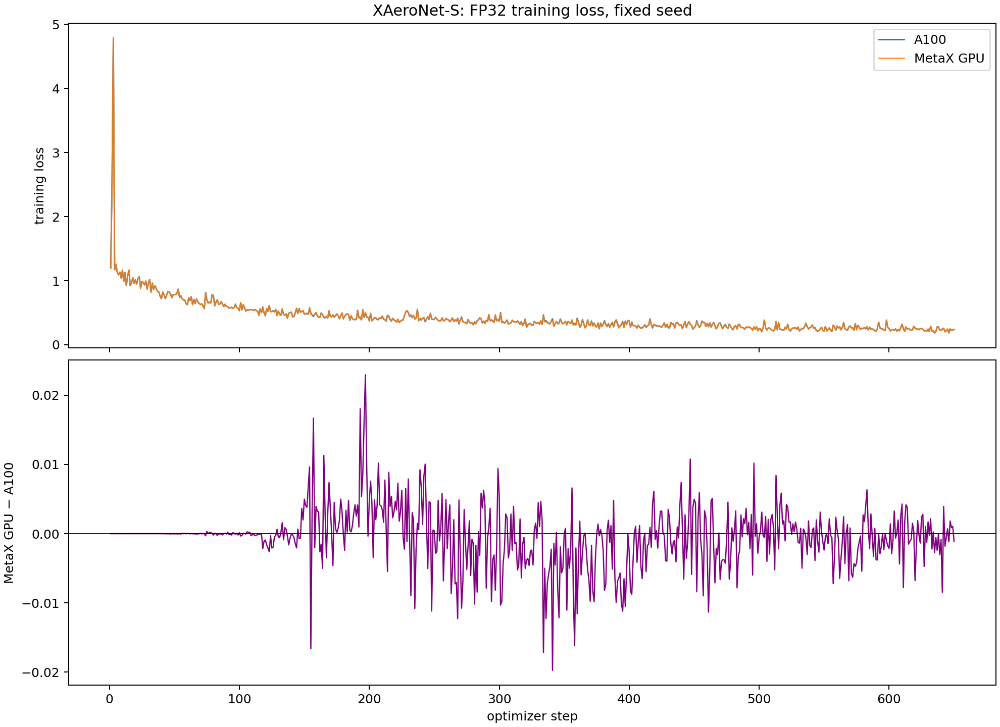
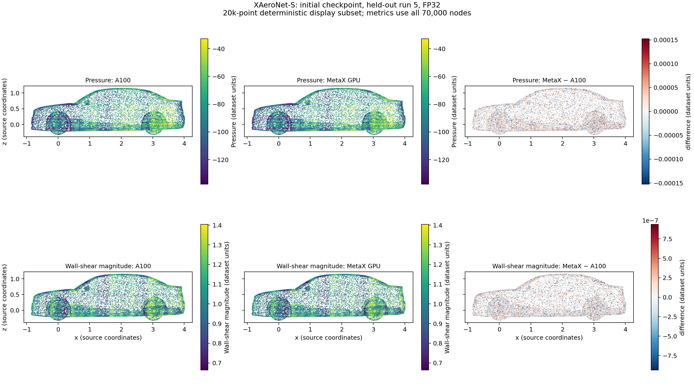
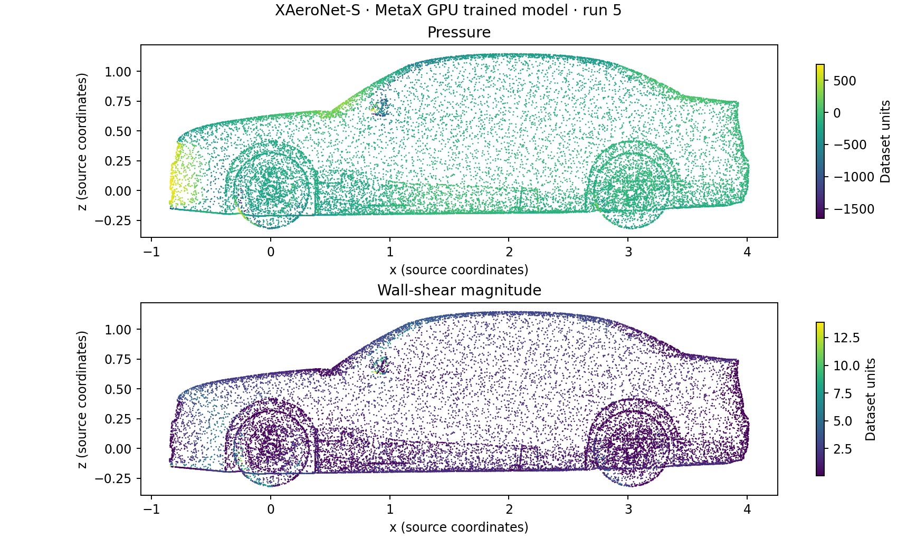

# 沐曦 GPU 运行 PhysicsNeMo XAeroNet 说明文档

## 一、XAeroNet 简介

XAeroNet 是 [PhysicsNeMo v2.0.0](https://github.com/NVIDIA/physicsnemo/tree/v2.0.0/examples/cfd/external_aerodynamics/xaeronet) 的大规模外部空气动力学的表面与体积代理模型集合，面向 DrivAerML 汽车几何，使用 STL 表面点云及体积网格特征预测表面和体积气动场。本文档固定使用 PhysicsNeMo 仓库提交 `1ca85d65ac2ce28ea9762910c09a954c08a37140`。

本目录采用文档与容器适配方式，不包含 PhysicsNeMo 源码、DrivAerML STL/VTK 数据、分区图和模型权重。PhysicsNeMo 使用 [CAE ML 的 DrivAerML 数据集](https://caemldatasets.org/drivaerml/)；XAeroNet-S 处理 STL 点云与 VTP 表面场，XAeroNet-V 处理 VTU 体积场及 SDF。

## 二、沐曦 GPU 环境配置与运行

### 2.1 环境准备

使用沐曦开发者社区提供的[PhysicsNeMo MACA 镜像](https://developer.metax-tech.com/softnova/docker?chip_name=MXC500&package_name=physicsnemo-maca:2.0.0-3.9.0.12-torch2.8-py312-ubuntu24.04-amd64)启动容器：

```bash
docker run --rm -it \
  --device=/dev/mxcd \
  --device=/dev/dri \
  --group-add video \
  --shm-size=8G \
  --security-opt seccomp=unconfined \
  --ulimit memlock=-1 \
  --ulimit stack=67108864 \
  -v /host_dir:/workspace \
  cr.metax-tech.com/public-ai-release/physicsnemo-maca:2.0.0-3.9.0.12-torch2.8-py312-ubuntu24.04-amd64 \
  /bin/bash
```

**参数说明：**

- `--device=/dev/mxcd --device=/dev/dri`：将沐曦 GPU 设备节点传入容器。
- `--group-add video`：将容器进程加入 `video` 组，以便访问 GPU 设备。
- `--shm-size=8G`：设置共享内存大小，供 PyTorch 和图数据加载使用。
- `--security-opt seccomp=unconfined`：允许 MACA 运行时使用所需的系统调用。
- `--ulimit memlock=-1`：取消内存锁定限制，避免 GPU 运行时申请锁页内存失败。
- `--ulimit stack=67108864`：设置线程栈大小，满足模型和数据处理过程的运行需求。
- `-v /host_dir:/workspace`：挂载工作目录；`/host_dir` 是主机路径，`/workspace` 是容器内路径。

### 2.2 验证环境

进入容器后，先验证沐曦 PyTorch 与 GPU 是否可用：

```bash
python -c "import torch; assert torch.cuda.is_available(); print('PyTorch version:', torch.__version__); print('CUDA OK:', torch.cuda.get_device_name(0))"
```

命令应打印 PyTorch 版本和 `cuda:0` 对应的沐曦 GPU 名称。例如：

```text
PyTorch version: 2.8.0+metax3.9.0.8
CUDA OK: MetaX C500
```

本说明已验证的输出为 `PyTorch version: 2.8.0+metax3.9.0.8`、`CUDA OK: MetaX C500`；实际版本号和设备名称以 PhysicsNeMo MACA 镜像及硬件型号为准。

如果 `torch.cuda.is_available()` 为 `False`，请先检查宿主机驱动、`/dev/mxcd` 和 `/dev/dri` 设备节点挂载、`video` 用户组权限以及容器启动参数，再继续安装 XAeroNet。

### 2.3 配置 MACA 编译环境

PhysicsNeMo MACA 镜像已配置 MACA 编译环境，并预装沐曦 PyTorch、 PhysicsNeMo 和 Warp；本案例不需要重复安装这些组件。进入容器后可验证：

```bash
python -c "import torch, physicsnemo, warp; assert torch.cuda.is_available(); print('PyTorch:', torch.__version__); print('PhysicsNeMo:', physicsnemo.__version__); print('Warp:', warp.__version__)"
```

命令应输出：

```text
PyTorch: 2.8.0+metax3.9.0.8
PhysicsNeMo: 2.0.0
Warp: 1.12.1
```

### 2.4 安装 XAeroNet 依赖

推荐使用第四节 Dockerfile 构建的镜像。镜像已包含 PhysicsNeMo 、沐曦 PyTorch 和 Warp。

本案例额外依赖：`trimesh==5.2.0`、`vtk==9.7.2`、`pyvista==0.49.2`、`tensorboard==2.21.0`。Trimesh/PyVista/VTK 处理几何与网格，TensorBoard 记录训练信息。

对应的安装命令：

```bash
PYPI_INDEX_URL=https://pypi.tuna.tsinghua.edu.cn/simple
python -m pip install --no-cache-dir \
    "trimesh==5.2.0"
python -m pip install --no-cache-dir --index-url="$PYPI_INDEX_URL" \
    "vtk==9.7.2" "pyvista==0.49.2"
python -m pip install --no-cache-dir "tensorboard==2.21.0"
```

验证依赖及案例入口（在交付镜像的默认工作目录执行）：

```bash
python -c 'import physicsnemo, torch, warp; assert physicsnemo.__version__ == "2.0.0"; print(physicsnemo.__version__, torch.__version__, warp.__version__)'
python -c 'import pathlib, runpy, sys; p=pathlib.Path("surface/train.py"); sys.path.insert(0, str(p.parent.resolve())); runpy.run_path(str(p))'
```

## 三、运行与验证

### 3.1 数据准备、训练与推理

数据来自 [DrivAerML](https://caemldatasets.org/drivaerml/)。在 PhysicsNeMo 源码目录执行官方脚本下载数据（脚本默认下载 500 个样本的 STL、VTP 和 VTU 文件，保存至 `drivaer_data_full`）：

```bash
cd examples/cfd/external_aerodynamics/xaeronet
bash download_aws_dataset.sh
```

按 [XAeroNet-S 官方数据准备流程](https://github.com/NVIDIA/physicsnemo/tree/v2.0.0/examples/cfd/external_aerodynamics/xaeronet#training-the-xaeronet-s-model)，在 `surface/conf/config.yaml` 中设置原始数据路径 `data_path`、分区路径及统计文件路径，然后将 STL 几何合并为单实体并生成表面分区图：

```bash
cd surface
python combine_stl_solids.py
python preprocessor.py
```

按案例要求划分训练、验证和测试分区，并使用训练分区计算归一化统计量：

```bash
python compute_stats.py
```

在 `surface` 目录使用官方入口训练，并在配置中指定检查点和测试分区路径后执行推理：

```bash
python train.py
python inference.py
```

本次对比使用 484 个可用 DrivAerML 样本，其中 387 个训练、48 个验证、49 个测试；两端从相同初始权重出发，采用 FP32 和相同样本顺序，各执行 650 次更新。

### 3.2 训练与推理结果

下图展示 A100 与 MetaX GPU 的训练 Loss。两端曲线基本一致，最后 65 步的平均 Loss 相对差异为 `0.221%`。



下图展示相同初始模型权重在留出样本 `run_5` 上的两端推理输出。以 A100 为基准，全部 70,000 个节点的四通道归一化输出相对 L2 误差为 `7.29e-7`，两端推理结果基本一致。图中显示压力和壁面剪切力模长的反归一化结果及其差值。



下图展示 MetaX GPU 训练 650 次更新后，对同一留出样本的压力和壁面剪切力模长预测。场图展示 20,000 个抽样节点。



## 四、Dockerfile 构建

本目录提供可直接构建的 Dockerfile。Dockerfile 使用上述 PhysicsNeMo MACA 镜像，安装第二节列出的本案例依赖，并在构建时核对 PhysicsNeMo v2.0.0 和 `surface/train.py` 案例入口；构建过程不打包 DrivAerML STL/VTK 数据、分区图和模型权重。

在 `XAeroNet` 目录执行：

```bash
docker build --build-arg PYPI_INDEX_URL=https://pypi.tuna.tsinghua.edu.cn/simple -t physicsnemo-xaeronet:2.0.0-maca .
```

构建完成后，使用下列命令启动镜像，并按第三节执行模型适配验证：

```bash
docker run --rm -it \
  --device=/dev/mxcd \
  --device=/dev/dri \
  --group-add video \
  --shm-size=8G \
  --security-opt seccomp=unconfined \
  --ulimit memlock=-1 \
  --ulimit stack=67108864 \
  -v /host_dir:/workspace \
  physicsnemo-xaeronet:2.0.0-maca \
  /bin/bash
```

请将 `/host_dir` 替换为主机侧实际工作目录。该挂载用于访问使用者的数据和输出。

## 五、其他

1. 开发者在初次使用曦云 GPU 运行 XAeroNet 时，遵循本手册搭建环境后，可以按照 [PhysicsNeMo XAeroNet 官网](https://github.com/NVIDIA/physicsnemo/tree/v2.0.0/examples/cfd/external_aerodynamics/xaeronet)的教程开展训练及推理。
2. 沐曦仅维护部分 case 的正确性，如出现运行问题，可提交 issue，亦可以在[沐曦开发者社区](https://developer.metax-tech.com)提交 bug 反馈。
3. 了解更多沐曦开源项目，请参考[沐曦开源社区](https://github.com/metax-maca)。

---

本文档仅提供相关软件的配置与使用说明，不包含亦不分发前述软件的源代码或目标代码，且不涉及对其源代码的任何修改。您按照本文档配置、部署或使用相关软件时，应遵守适用许可证规定的条款与条件。相关软件的源代码、许可证全文、版权与归属声明及其他项目文档，请以其官方网站或原始发布页面为准。

Copyright (c) 2026 MetaX Integrated Circuits (Shanghai) Co., Ltd. All rights reserved.
