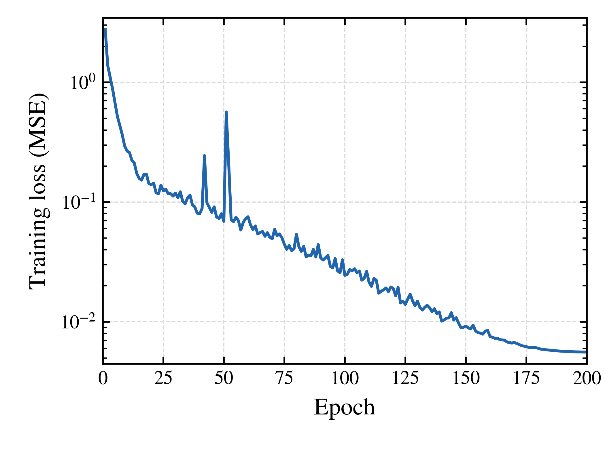
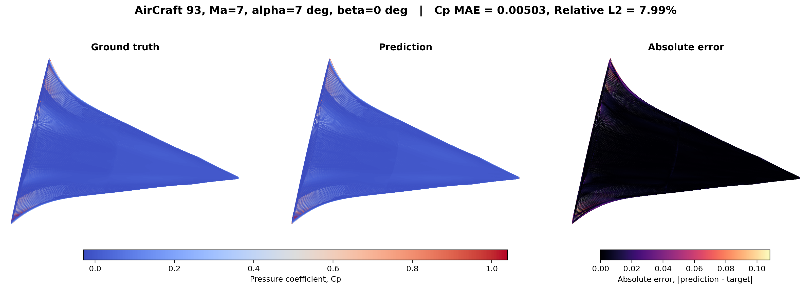

# 沐曦 GPU 运行 Transolver++ 说明文档

## 一、Transolver++ 简介

[Transolver++](https://github.com/thuml/Transolver_plus) 是面向大规模几何 PDE 预测的神经网络求解器。模型通过 eidetic states 聚合大规模网格上的物理状态，并采用适合多 GPU 并行的线性复杂度实现。本目录说明在沐曦 GPU 上完成 AirCraft 数据预处理、单卡训练、推理评估及升力系数后处理的方法。

本文固定使用 commit `d5a23bc734a0ebac56384cf72049a26af9673452`。项目采用 MIT License；项目源码、AirCraft 数据集和训练 checkpoint 不随本目录分发。

相关资源：

- [Transolver++ 仓库](https://github.com/thuml/Transolver_plus)
- [Transolver++ 论文](https://arxiv.org/abs/2502.02414)
- [AirCraft 数据集下载入口](https://github.com/thuml/Transolver_plus#Get-Started-from-AirCraft-dataset)
- [沐曦开发者社区](https://developer.metax-tech.com/softnova/docker)

## 二、沐曦 GPU 环境配置与运行

### 2.1 环境准备

使用沐曦开发者社区提供的 MACA PyTorch 基础镜像：

```text
cr.metax-tech.com/public-library/maca-pytorch:3.8.2.6-torch2.8-py312-ubuntu24.04-amd64
```

启动容器并挂载工作目录与 AirCraft 数据集：

```bash
docker run -it --name transolver-plus-maca \
  --device=/dev/mxcd \
  --device=/dev/dri \
  --group-add video \
  --shm-size=16G \
  --security-opt seccomp=unconfined \
  --ulimit memlock=-1 \
  --ulimit stack=67108864 \
  -v /host/work:/workspace \
  -v /host/AirCraft:/workspace/data/AirCraft \
  cr.metax-tech.com/public-library/maca-pytorch:3.8.2.6-torch2.8-py312-ubuntu24.04-amd64 \
  /bin/bash
```

其中 `/host/work` 和 `/host/AirCraft` 应替换为实际宿主机路径。基础镜像中的 MACA PyTorch 不应被通用 CUDA PyTorch 覆盖。

### 2.2 安装 Transolver++

```bash
apt-get update
apt-get install -y --no-install-recommends git

cd /workspace
git clone https://github.com/thuml/Transolver_plus.git
cd Transolver_plus
git checkout --detach d5a23bc734a0ebac56384cf72049a26af9673452
```

安装除 PyTorch 以外的依赖：

```bash
python -m pip install --no-deps \
  h5py==3.16.0 timm==1.0.30 einops==0.8.1 \
  -i https://pypi.tuna.tsinghua.edu.cn/simple
```

应用本目录提供的补丁，在 Transolver++ 源码中新增 AirCraft 数据预处理、模型评估和升力系数后处理脚本：

```bash
cd /workspace/Transolver_plus
mkdir -p /workspace/Transolver_plus/tools
patch --dry-run --binary -p1 \
  < /workspace/metax-opensource/Models/Transolve-plus/patch/add_maca_helpers.patch
patch --binary -p1 \
  < /workspace/metax-opensource/Models/Transolve-plus/patch/add_maca_helpers.patch
chmod +x tools/prepare_aircraft.py \
  tools/evaluate_aircraft.py \
  tools/calculate_lift_metrics.py \
  tools/plot_aircraft_cp.py
```

补丁适用于 commit `d5a23bc734a0ebac56384cf72049a26af9673452`，只新增四个辅助脚本，不修改已有文件。补丁说明和许可见 [`patch/README-PATCH`](patch/README-PATCH) 与 [`patch/LICENSE`](patch/LICENSE)。

### 2.3 验证环境

```bash
mx-smi
python - <<'PY'
import torch
import h5py
import timm
import einops

print("PyTorch:", torch.__version__)
print("CUDA available:", torch.cuda.is_available())
print("GPU count:", torch.cuda.device_count())
print("h5py:", h5py.__version__)
print("timm:", timm.__version__)
print("einops:", einops.__version__)
PY
```

本次验证环境如下：

```text
GPU: MetaX C500
MACA: 3.8.2.6
PyTorch: 2.8.0+metax3.8.2.2
NumPy: 1.26.4
h5py: 3.16.0
timm: 1.0.30
einops: 0.8.1
```

MACA 的 CUDA 兼容接口可能返回兼容设备名称，物理设备型号应以 `mx-smi` 为准。

## 三、AirCraft 数据准备、训练与评估

### 3.1 数据集与数据划分

AirCraft 数据集包含 30 种飞机几何，每种几何包含 5 个来流工况，共 150 个样本。每个样本约包含 33 万个表面点，输入包括表面坐标、法向量以及 Mach 数、攻角和侧滑角，输出为：

```text
Cp, rho, u, v, w, Pressure
```

固定顺序划分：

| 数据用途 | 几何 | 工况数 |
| --- | --- | ---: |
| 训练集 | 前 28 种飞机 | 140 |
| 测试集 | 飞机 92、93 | 10 |

原始数据目录应包含 `result.csv`，以及如下 Tecplot 文件：

```text
AirCraft/
├── result.csv
├── 1/Mach02.00_Alpha00.00_Beta00.00/Components.i.dat
├── 1/Mach07.00_Alpha00.00_Beta00.00/Components.i.dat
└── ...
```

### 3.2 数据预处理

模型读取 HDF5 文件。执行本目录提供的转换脚本：

```bash
cd /workspace/Transolver_plus
python tools/prepare_aircraft.py \
  --data-dir /workspace/data/AirCraft \
  --config /workspace/Transolver_plus/airplane_dataset_140_10.json \
  --test-count 10
```

转换后的每个 HDF5 文件包含：

| 字段 | 形状 | 含义 |
| --- | --- | --- |
| `pos` | `(331971, 3)` | 表面点坐标 |
| `normals` | `(331971, 3)` | 面积加权顶点法向 |
| `values` | `(331971, 6)` | `Cp, rho, u, v, w, Pressure` |
| `Ma/alpha/beta` | HDF5 attributes | 来流条件 |

 `dataset/dataset.py` 固定从 `/aircraft_docker/airplane_dataset.json` 读取划分配置，因此训练前需要复制配置：

```bash
mkdir -p /aircraft_docker
cp /workspace/Transolver_plus/airplane_dataset_140_10.json \
  /aircraft_docker/airplane_dataset.json
```

### 3.3 训练

本次使用一张 MetaX C500，batch size 为 1，训练 200 epoch。模型采用 4 层、8 个 attention heads、256 hidden channels 和 32 slices，共 1,741,738 个可训练参数。

```bash
cd /workspace/Transolver_plus
mkdir -p output/aircraft_140train_10test_200ep
cp airplane_dataset_140_10.json \
  output/aircraft_140train_10test_200ep/airplane_dataset.json
cd output/aircraft_140train_10test_200ep

CUDA_VISIBLE_DEVICES=0 \
PYTHONPATH=/workspace/Transolver_plus \
python -m torch.distributed.run --standalone --nproc_per_node=1 \
  /workspace/Transolver_plus/main_airplane.py \
  --nb_epochs 200 \
  --batch_size 1 \
  --val_iter 10 \
  --lr 0.001 \
  --fold_id 0 \
  --dataset airplane \
  --cfd_model transolver_plus \
  --data_dir /workspace/data/AirCraft \
  --save_dir /workspace/data/AirCraft \
  > stdout.log 2>&1
```

训练入口将日志和 checkpoint 写入当前目录。训练完成后主要文件包括：

```text
model_200.pth
log_200.json
train.log
stdout.log
```

### 3.4 推理评估

 `main_airplane.py --eval` 使用固定数据路径和固定样本数量。本目录提供的评估脚本按训练时保存的 140/10 配置重新评估最终模型，并导出逐工况误差：

```bash
cd /workspace/Transolver_plus
mkdir -p output/aircraft_evaluation

CUDA_VISIBLE_DEVICES=0 \
python tools/evaluate_aircraft.py \
  --repo /workspace/Transolver_plus \
  --run-dir /workspace/Transolver_plus/output/aircraft_140train_10test_200ep \
  --data-dir /workspace/data/AirCraft \
  --output-dir /workspace/Transolver_plus/output/aircraft_evaluation \
  --seed 0 \
  --save-predicted-cp
```

### 3.5 升力系数后处理

使用预测 `Cp` 和原始三角网格计算升力系数：

```bash
python tools/calculate_lift_metrics.py \
  --data-dir /workspace/data/AirCraft \
  --split /workspace/Transolver_plus/output/aircraft_140train_10test_200ep/airplane_dataset.json \
  --predicted-cp-dir /workspace/Transolver_plus/output/aircraft_evaluation/predicted_cp \
  --output-dir /workspace/Transolver_plus/output/aircraft_evaluation
```

脚本先对三角面的三个顶点 `Cp` 取平均，再计算：

```text
F_Cp = -sum(Cp_face * area_vector)
CL   = CN * cos(alpha) - CA * sin(alpha)
```

AirCraft 坐标单位为 mm，本次使用 `A_ref = 10^6 mm² = 1 m²`。

### 3.6 训练曲线

下图为 200 epoch 训练 MSE。纵轴采用对数刻度，曲线保留原始训练波动，没有平滑处理。



## 四、训练与推理结果

### 4.1 训练结果

| 指标 | 结果 |
| --- | ---: |
| Epoch | 200 |
| 最终训练 MSE | 0.00559911 |
| 最终测试 MSE | 0.01790535 |
| 参数量 | 1,741,738 |

### 4.2 推理结果

| 指标 | MetaX C500 | [论文 Transolver++（Table 2）](https://arxiv.org/html/2502.02414) |
| --- | ---: | ---: |
| Surface pressure Relative L2 | 6.2847% | 6.4% |
| Lift coefficient Relative L2 | 1.1479% | 1.4% |
| Lift coefficient R² | 0.999735 | 0.999 |

升力指标基于 10 个测试工况的完整表面 `Cp` 积分。Relative L2 和 R² 分别按以下公式计算：

```text
Relative L2 = ||CL_pred - CL_true||2 / ||CL_true||2
R² = 1 - sum((CL_pred - CL_true)²) / sum((CL_true - mean(CL_true))²)
```

### 4.3 表面压力系数可视化

飞机 93 在 `Ma=7、攻角 7°、侧滑角 0°` 工况下完整表面 331,971 个点的压力系数 `Cp` 真值、预测值及绝对误差，其中 `Cp MAE` 为 0.00503，Relative L2 为 7.99%。



使用推理阶段保存的逐点 `Cp` 可复现该图：

```bash
python tools/plot_aircraft_cp.py \
  --surface /workspace/data/AirCraft/93/Mach07.00_Alpha07.00_Beta00.00/Components.i.dat \
  --prediction /workspace/Transolver_plus/output/aircraft_evaluation/predicted_cp/93_7.0_7.0_0.0.npy \
  --output /workspace/Transolver_plus/output/aircraft_evaluation/aircraft_cp_truth_prediction_error.png \
  --case-label "AirCraft 93, Ma=7, alpha=7 deg, beta=0 deg" \
  --max-points 0
```

## 五、常见问题与注意事项

### 5.1 找不到划分配置

数据集代码固定读取 `/aircraft_docker/airplane_dataset.json`。如果出现 `FileNotFoundError`，请创建该目录并复制预处理生成的 JSON 配置。

### 5.2 Dockerfile 构建

本目录提供 [Dockerfile](Dockerfile)。构建时会拉取固定版本的 Transolver++ 源码、应用本目录的辅助工具 patch，并安装运行依赖；基础镜像自带的 MACA PyTorch 不会被替换：

```bash
cd metax-opensource/Models/Transolve-plus
docker build -t transolver-plus-maca .
```

默认基础镜像为 MACA 3.8.2.6、PyTorch 2.8、Python 3.12 和 Ubuntu 24.04。运行时挂载 AirCraft 数据及结果目录：

```bash
docker run --rm -it \
  --device=/dev/mxcd \
  --device=/dev/dri \
  --group-add video \
  --shm-size=16G \
  -v /host/AirCraft:/workspace/data/AirCraft \
  -v /host/output:/workspace/Transolver_plus/output \
  transolver-plus-maca
```

将 `/host/AirCraft` 和 `/host/output` 替换为宿主机上的实际目录。上游 commit、基础镜像可在构建时通过 `--build-arg TRANSOLVER_COMMIT=...` 和 `--build-arg MACA_BASE_IMAGE=...` 指定；如更换版本，应确认与补丁及依赖兼容。

## 六、其他

1. 本文结果来自 MetaX C500 单卡、140 个训练工况、10 个测试工况和 200 epoch 训练。
2. 本目录不提供 AirCraft 数据集或训练 checkpoint；使用者应从原始发布页面获取并遵守其许可条款。
3. 模型自身问题请反馈至 [Transolver++ 仓库](https://github.com/thuml/Transolver_plus)，MACA 环境问题可通过沐曦开发者社区反馈。

---

本文档仅提供相关软件的配置与使用说明，不包含亦不分发前述软件的源代码或目标代码，且不涉及对其源代码的任何修改。您按照本文档配置、部署或使用相关软件时，应遵守适用许可证规定的条款及条件。相关软件的源代码、许可证全文、版权与归属声明及其他项目文档，请以其官方网站或原始发布页面为准。

Copyright (c) 2026 MetaX Integrated Circuits (Shanghai) Co., Ltd. All rights reserved..
